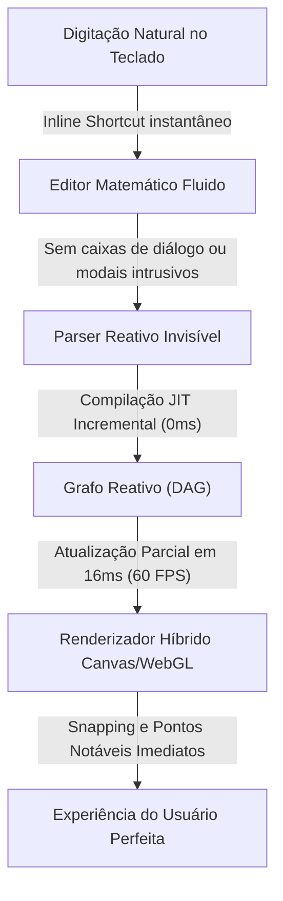
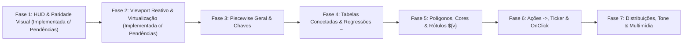

# Estudo Profundo do Desmos, Relatório Técnico Exaustivo e Plano Diretor de Reforma: Motorzaoo -> Padrão Desmos (Paridade 100%)

---

## 1. Registro Transparente de Páginas, Fontes e Estado Mobile vs. Desktop Analisados

Para assegurar 100% de integridade e cobertura exaustiva da base de conhecimento do Desmos ([/r/Besmos/wiki/features-and-bugs/](https://www.reddit.com/r/Besmos/wiki/features-and-bugs/)), das medições empíricas no Desmos Graphing Calculator em resolução de desktop (`1920×1080`, `DPR = 1.0`), da comparação de estados serializados entre **Desktop (`jsonlmdesmo.txt`)** e **Mobile iPhone 16 (`desmosjsoncelulariphone16.txt`)**, e do gráfico mestre oficial [https://www.desmos.com/calculator/5ls5ggt5gd?lang=pt-BR](https://www.desmos.com/calculator/5ls5ggt5gd?lang=pt-BR), foram extraídos e consolidados:

### 1.1. As 32 Páginas da Wiki Oficial
| # | Página / Subpágina | URL Completa Acessada | Tópico Principal Estudado |
|---|---|---|---|
| 1 | **Main Index** | `https://www.reddit.com/r/Besmos/wiki/features-and-bugs/` | Mapa completo de recursos, arquitetura e convenções |
| 2 | **UI** | `https://www.reddit.com/r/Besmos/wiki/features-and-bugs/ui` | Top bar, painel de expressões, graph paper, teclado virtual, menus |
| 3 | **Graphing** | `https://www.reddit.com/r/Besmos/wiki/features-and-bugs/graphing` | Variáveis, sliders, animações, plotagem explícita e implícita |
| 4 | **Built-in Functions** | `https://www.reddit.com/r/Besmos/wiki/features-and-bugs/built-in` | Catálogo exaustivo de funções nativas, trig, geometria, cálculo, stats |
| 5 | **Points** | `https://www.reddit.com/r/Besmos/wiki/features-and-bugs/points` | Pontos clicáveis/arrastáveis, coordenadas `.x/.y`, rótulos dinâmicos `${v}` |
| 6 | **Lists** | `https://www.reddit.com/r/Besmos/wiki/features-and-bugs/lists` | Sequências `...`, broadcasting aritmético, filtros `L[L>0]`, comprehensions |
| 7 | **Tables** | `https://www.reddit.com/r/Besmos/wiki/features-and-bugs/tables` | Tabelas de pares $(x_1, y_1)$, autocompletar de passos com Enter, conversão |
| 8 | **Inequalities** | `https://www.reddit.com/r/Besmos/wiki/features-and-bugs/inequality` | Desigualdades lineares e implícitas, chaves `{}` lógicas (AND/OR), sombreamento |
| 9 | **Sum & Product** | `https://www.reddit.com/r/Besmos/wiki/features-and-bugs/sum-and-prod` | Operadores de somatório $\sum$ e produtório $\prod$ com limites dinâmicos |
| 10 | **Calculus** | `https://www.reddit.com/r/Besmos/wiki/features-and-bugs/calculus` | Derivadas $d/dx, f'(x)$, integrais definidas, limites no infinito $\infty$, integrais duplas |
| 11 | **Complex Mode** | `https://www.reddit.com/r/Besmos/wiki/features-and-bugs/complex` | Unidade imaginária $i$, plotagem no plano complexo, funções `real, imag, conj, arg` |
| 12 | **Recursion** | `https://www.reddit.com/r/Besmos/wiki/features-and-bugs/recursion` | Funções recursivas, condições de parada base, recursão mútua, tabelas |
| 13 | **Parametric** | `https://www.reddit.com/r/Besmos/wiki/features-and-bugs/parametric` | Curvas paramétricas $(x(t), y(t))$, domínio editável de $t$, animações |
| 14 | **Polar** | `https://www.reddit.com/r/Besmos/wiki/features-and-bugs/polar` | Coordenadas polares $r=f(\theta)$, domínio de $\theta$ ($0 \le \theta \le 12\pi$), grade polar |
| 15 | **Substitution** | `https://www.reddit.com/r/Besmos/wiki/features-and-bugs/substitution` | Operador `with` para substituição contextual de variáveis locais |
| 16 | **Actions & Ticker** | `https://www.reddit.com/r/Besmos/wiki/features-and-bugs/actions` | Operador de atribuição reativa `->`, mutação simultânea, ticker com $dt$ |
| 17 | **Matrices** | `https://www.reddit.com/r/Besmos/wiki/features-and-bugs/matrices` | Matrizes dinâmicas, `#rc`, compreensão `[;]`, indexação `M[r;c]`, transformação $M(x,y)$ |
| 18 | **Colors** | `https://www.reddit.com/r/Besmos/wiki/features-and-bugs/colors` | Cores customizadas `rgb(r,g,b)`, `hsv(h,s,v)`, `oklab`, `oklch`, `okhsv`, `\textcolor` |
| 19 | **Tone** | `https://www.reddit.com/r/Besmos/wiki/features-and-bugs/tone` | Síntese de som via Web Audio API, `tone(freq, vol)`, acordes e polifonia |
| 20 | **Inference** | `https://www.reddit.com/r/Besmos/wiki/features-and-bugs/inference` | Testes estatísticos `ttest`, `ztest`, `chisqtest`, intervalos de confiança |
| 21 | **Regressions** | `https://www.reddit.com/r/Besmos/wiki/features-and-bugs/regressions` | Regressão não-linear $y_1 \sim f(x_1)$, resíduos $e_1$, $R^2$, $\text{RMSE}$, sistemas |
| 22 | **Accessibility** | `https://www.reddit.com/r/Besmos/wiki/features-and-bugs/accessibility` | Audio Trace (`Alt+T` / `H`), Braille 6 teclas (Nemeth/UEB), Projector Mode |
| 23 | **Advanced Features** | `https://www.reddit.com/r/Besmos/wiki/features-and-bugs/advanced` | Máscaras de imagem com polígonos (`?authorFeatures`), configurações de autor |
| 24 | **Bugs & Glitches** | `https://www.reddit.com/r/Besmos/wiki/features-and-bugs/bugs` | Limitações de amostragem (`!roots`), falhas de quadratura (`!integral`), Bernard |
| 25 | **Bernard Bug** | `https://www.reddit.com/r/Besmos/wiki/features-and-bugs/bernard` | Algoritmo Quadtree BFS de plotagem implícita, cota de $2^{14}=16.384$ folhas, fração $620/14.400$ |
| 26 | **Floating Point** | `https://www.reddit.com/r/Besmos/wiki/features-and-bugs/fp` | IEEE-754 64 bits, esgotamento de mantissa $2^{53}$, zero negativo ($-0$), propagação de `NaN` |
| 27 | **LaTeX Commands** | `https://www.reddit.com/r/Besmos/wiki/features-and-bugs/latex` | MathQuill, operadores tipáveis, letras gregas, automações de dimensionamento `\left \right` |
| 28 | **Fragile Functions** | `https://www.reddit.com/r/Besmos/wiki/features-and-bugs/fragile` | Primitivas internas compiladas (`rtxsqpone`, `hypot`, `argmin`, `zeroMatrix`, `hcat`, `vcat`) |
| 29 | **Code Behind Desmos** | `https://www.reddit.com/r/Besmos/wiki/features-and-bugs/code` | Shared Assets monolíticos (`~500 KB` CSS, `~4.5 MB` JS), arquitetura SPA |
| 30 | **JSON Graph State** | `https://www.reddit.com/r/Besmos/wiki/features-and-bugs/json` | Esquema `Calc.getState()` (`version: 11`, `randomSeed`), imutabilidade Desktop vs. Mobile |
| 31 | **URL Tags & Query Strings** | `https://www.reddit.com/r/Besmos/wiki/features-and-bugs/url-tags` | Parâmetros de URL (`?authorFeatures`, `?showPerformanceMeter`, `?forceTouchDevice`, etc.) |
| 32 | **Easter Eggs & Entities** | `https://www.reddit.com/r/Besmos/wiki/features-and-bugs/easter-eggs` | Easter eggs nativos (`pride`, `betchacant`, `teapot`) e entidades especiais |

### 1.2. O Gráfico Mestre Oficial Analisado
- **URL**: `https://www.desmos.com/calculator/5ls5ggt5gd?lang=pt-BR`
- **Título**: *"All Desmos Features You Should Know"* (mantido por `u/Mandelbrot4207`).
- **Endpoint do Estado JSON**: `https://www.desmos.com/calc-states/production/version/5ls5ggt5gd/7bbba660-cadb-11f1-94a0-2bfe6d1e7ad0`
- **Conteúdo Analisado**: 839 elementos totais, organizados em 33 pastas hierárquicas, englobando todas as anotações didáticas, casos práticos, expressões com controles deslizantes e casos de teste reais do Desmos.

---

## 2. A Filosofia, a Psicologia do "Desmos Feel" e a Camada Visual Externa (UI/UX)

O que torna a experiência do Desmos a referência mundial de fluidez em matemática computacional é a **ausência total de atrito cognitivo**:



### 2.1. Os 6 Pilares Inegociáveis da Experiência Desmos
1. **Zero Bloqueios e Zero Modais**:
   - O usuário nunca é interrompido por popups de confirmação ou alertas de erro ruidosos.
   - Enquanto o usuário digita uma expressão transitória (ex.: `\int_1^2 x`), o sistema aguarda silenciosamente ou sinaliza discretamente no ícone da margem esquerda sem tarjas intrusivas.
2. **Atalhos Mágicos Transparentes**:
   - Digitar `pi` vira $\pi$; digitar `/` cria a fração e posiciona o cursor no denominador; digitar `int` gera o símbolo de integral; digitar `matrix` ou `#23` gera uma matriz inline $\begin{bmatrix} \dots \end{bmatrix}$ com o cursor já posicionado na célula $(1,1)$; digitar `->` cria a seta de ação $\to$.
3. **Broadcasting e Vetorização Implícita**:
   - Vetorização universal: `[1, 2, 3] + 5 = [6, 7, 8]`. Grids de pontos: `([1, 2, 3], [4, 5, 6])` plota 3 pontos instantaneamente.
4. **Resolução Silenciosa de Variáveis**:
   - Identifica quando variáveis são livres (propondo slider antes de plotar a curva) ou vinculadas/locais ($dx$, $dt$, variáveis de somatório, parâmetros de compreensão), nunca sugerindo sliders fantasmas. No modo 2D, `z` é tratado como parâmetro livre elegível a slider; no modo 3D, `z` é coordenada espacial reservada.
5. **Colchetes e Tipografia Elástica**:
   - Colchetes de matrizes e parênteses abraçam **rigorosamente** o conteúdo interno, adaptando-se harmonicamente à largura da barra lateral.
6. **Realce Cromático de Foco com Feedback Visual**:
   - Ao focar em qualquer bloco de expressão, a aba lateral esquerda transiciona para azul suave (`#d2e7f5`) com borda lateral de destaque (`#2d70b3`), conectando a expressão ao traçado correspondente no gráfico.

### 2.2. Barra Superior (Top Bar), Gestão de Arquivos e Persistência
A barra superior do ecossistema Desmos centraliza as primitivas de controle global de navegação, persistência de dados em servidor remoto e controle de sessão de usuário. O modelo de persistência opera via geração de links estáticos vinculados a identificadores hash alfanuméricos de base 36 (10 caracteres). O salvamento inicial atribui um hash estático único; atualizações subsequentes no mesmo workspace sobrescrevem o estado lógico serializado mantendo a mesma referência de URL.

| Recurso / Atalho | Descrição Técnica / Limite de Engenharia |
| :--- | :--- |
| `Ctrl+O` / `Cmd+O` | Invoca a caixa de diálogo modal para navegação no diretório de arquivos salvos do usuário e acesso à galeria pública de exemplos nativos do Desmos. |
| `Ctrl+S` / `Cmd+S` | Dispara o pipeline de gravação assíncrona. Persiste a árvore estrutural do gráfico e atualiza o estado remoto no mesmo hash de URL. |
| **Limite de Arquivo** | **5 MB (`5.242.880 bytes`)** de payload limite para o pacote completo de salvamento (unindo o JSON de estado, a imagem thumbnail de pré-visualização e meta-informações de título). Payload acima deste patamar resulta em rejeição do servidor, exigindo extração local via console JS. |
| **Autenticação e 2FA** | Suporta cadastro via e-mail direto (autenticação legada por senha, sem suporte nativo a 2FA) ou provedores federados de Single Sign-On (SSO) via Google e Apple (que delegam e estendem a camada de proteção com suporte a 2FA). |
| ***Sparkle Icon*** | Elemento efêmero de UI injetado anualmente no período de **15 de novembro a 15 de janeiro**, redirecionando o tráfego para o *Desmos Math Art Contest* e disponibilizando o repositório público de projetos aprovados em `desmos.com/art`. |
| **Exportação / Compartilhamento** | Permite a instanciação de *snapshots* (links imutáveis desvinculados da conta do autor), renderização de rasterização de imagem (PNG/SVG), rotina de impressão vetorial e geração de código de incorporação HTML em elemento `<iframe>`. |

### 2.3. Lista de Expressões (Expression Lines) e Manipulação de Elementos
O sistema aceita os seguintes tipos de nós estruturais:
- **Notas (`note` ou `"`):** Comentários de texto simples fora do pipeline de cálculo. `Shift+Enter` força a inserção de quebra de linha (`\n`) no bloco de texto.
- **Pastas (`folder`):** Agrupam logicamente linhas de expressão, indicadas por um recuo visual acoplado a uma barra cinza vertical no delimitador esquerdo. **Restrição Arquitetural:** O motor do Desmos não permite o aninhamento de pastas dentro de outras pastas (*folder nesting is disabled*).
- **Tabelas (`table`):** Entrada discreta de vetores de pares ordenados $(x_n, y_n)$ com avaliação funcional automática de variáveis externas.
- **Ticker (`ticker`):** Relógio de execução contínua que dispara Ações iterativas em frequências configuráveis ($dt$).
- **Inferência Estatística (`inference`):** Estrutura testes de hipóteses e intervalos de confiança (como teste $t$ de Student para 2 amostras independentes).
- **Imagens (`image`):** Suporta formatos JPG, PNG, WEBP, GIF, BMP e ICO.
  - *Pipeline de Processamento Interno:* O motor realiza otimização automática no upload. Arquivos GIF animados e imagens animadas (PNG/WEBP) **não mantêm animação** na viewport; o sistema extrai e exibe estritamente o primeiro quadro estático, convertendo GIFs internamente para **PNG estático**. Imagens PNG convencionais que excedem limites padrão de dimensão e peso são convertidas automaticamente para **JPG** para mitigar o inchaço do JSON de estado.
  - *Máscara de Recorte via Author Features:* Ao habilitar a query string `?authorFeatures`, o painel de propriedades da imagem expõe mascaramento por polígonos, curvas paramétricas ou inequações regionais.
- **Atalhos Globais da Árvore de Expressões:** `Ctrl+Z` (Undo), `Ctrl+Shift+Z` ou `Ctrl+Y` (Redo), `Ctrl+F` (busca sintática em expressões) e `Ctrl+Shift+F` (substituição e renomeação global de identificadores de variáveis).

### 2.4. Papel de Gráfico (Graph Paper), Calculadora Geométrica e Acessibilidade
- **Configurações Visuais do Papel de Gráfico (Chave Inglesa):**
  - *Projector Mode:* Multiplica globalmente a escala de fontes CSS e amplia a espessura das linhas do traçado.
  - *Reverse Contrast:* Inverte a matriz de cores do canvas (fundo escuro com linhas claras). **Nota de Arquitetura:** Este estado é um parâmetro temporário mantido apenas em memória de sessão e **não é gravado** na estrutura do JSON do gráfico (`getState()`).
  - *Eixos e Viewport:* Suporta alternância individual entre escala linear e escala logarítmica para os eixos $X$ e $Y$, travamento rígido de movimentação (`lockViewport`), projeção no plano complexo e visualização em grade de coordenadas polares.
- **Calculadora Geométrica:**
  - *Ferramentas Nativas:* Pontos, segmentos de reta, retas infinitas, semirretas (*rays*), vetores, arcos circulares (3 pontos), polígonos e interseções.
  - *Transformações Rígidas:* Dilatação (escala em relação a ponto central), Rotação (ângulo em graus/radianos ao redor de pivô), Reflexão (em relação a reta/segmento guia) e Translação (definida por magnitude e direção de um vetor).
- **Acessibilidade e Tecnologia Assistiva:**
  - *Leitor de Tela Adaptado:* Converte LaTeX em linguagem falada estruturada ($\cos(x) \to$ "cosseno de x", $x^2 \to$ "x ao quadrado", $\frac{1}{2} \to$ "um meio").
  - *Audio Trace (`Alt+T` / `Option+T` e tecla `H` para Hear Graph):* Mapeia os valores de $y$ para frequências senoidais na Web Audio API (valores de $y$ descendentes geram tons graves; crescentes geram frequências agudas contínuas).
  - *Entrada de 6 Teclas (Braille Nemeth e UEB):*
    - **Gregas Minúsculas:** $\alpha=$ `.a`, $\beta=$ `.b`, $\gamma=$ `.g`, $\delta=$ `.d`, $\epsilon=$ `.e`, $\zeta=$ `.z`, $\eta=$ `.:`, $\theta=$ `.?`, $\iota=$ `.i`, $\kappa=$ `.k`, $\lambda=$ `.l`, $\mu=$ `.m`, $\nu=$ `.n`, $\xi=$ `.x`, $o=$ `o`, $\pi=$ `.p`, $\rho=$ `.r`, $\sigma=$ `.s`, $\tau=$ `.t`, $\upsilon=$ `.u`, $\phi=$ `.f`, $\chi=$ `.&`, $\psi=$ `.y`, $\omega=$ `.w`.
    - **Gregas Maiúsculas:** $\Gamma=$ `.,g`, $\Delta=$ `.,d`, $\Theta=$ `.,?`, $\Lambda=$ `.,l`, $\Xi=$ `.,x`, $\Pi=$ `.,p`, $\Sigma=$ `.,s`, $\Upsilon=$ `.,u`, $\Phi=$ `.,f`, $\Psi=$ `.,y`, $\Omega=$ `.,w`. *(Nota: `.,s` e `.,p` invocam diretamente $\sum$ e $\prod$; para usar $\Sigma$ e $\Pi$ como identificadores algébricos, requer-se `\Sigma` e `\Pi` via LaTeX).*
    - **Impressoras Táteis Homologadas:** Tiger Columbia, VP Max, Enabling Technologies Romeo 60 e Juliet 120.

---

## 3. Auditoria Métrica de Paridade Visual, Mobile vs. Desktop e Square Zoom 1:1

### 3.1. Tabela Métrica Pixel-by-Pixel (Desktop `1920×1080`, `DPR = 1.0`)

| Componente / Elemento de UI | Medida Oficial Desmos (`px`) | Especificação no `Motorzaoo` | Veredito de Paridade |
| :--- | :--- | :--- | :--- |
| **Header Global da Aplicação** | Altura: **`46px`** (`1920×46`, `#2a2a2a`) | Barra superior escura com logo, nome do gráfico, botões Desfazer/Refazer e menu de conta | Implementado na Fase 1 |
| **Painel Lateral (Sidebar)** | Largura: **`500px`** em 1080p | Largura inicial: **`500px`**; `min-width: 220px`; colapso `< 150px` | Implementado na Fase 1 |
| **Topbar de Expressões** | Altura: **`48px`** (`#f6f6f6`, borda inferior `1px solid #dcdcdc`) | Botões de `40×40px`, raio `5px` (`+`, `Undo`, `Redo`, `Edit List` engrenagem, `Hide <<`) | Implementado na Fase 1 |
| **Aba Lateral de Índice (`.dcg-tab`)** | Largura: **`38px`**, fundo **`#eeeeee`** (normal) e **`#d2e7f5`** (foco) | Índice `10.4px` no canto superior esquerdo (`top: 2px, left: 3px, #666`); círculo de cor `29×29px` centralizado | Implementado na Fase 1 |
| **Linha de Expressão** | Altura mínima: **`43px`** (compacta) / **`57px`** (foco ativo) | Separador de linhas: `1px solid #dcdcdc` (`rgb(220, 220, 220)`) | Implementado na Fase 1 |
| **Caixa de Avaliação (`= resultado`)** | Fundo `#f5f5f5`, borda `1px solid #dcdcdc`, raio `3px`, texto `#333333` | Pílula alinhada no canto inferior direito com botão interativo `[a/b]` de fração racional | Implementado na Fase 1 |
| **Botão Wrench (Configurações)** | **`37×37px`**, fundo `#ededed`, borda `1px solid rgba(0,0,0,0.1)`, raio `5px`, margem `5px` | Posicionado em `top: 5px, right: 5px` | Implementado na Fase 1 |
| **Modal da Chave Inglesa** | Largura: **`290px`**, raio: **`6px`**, fundo branco, sombra suave | Sem cabeçalho com botão fechar; fecha ao clicar fora ou na chave | Implementado na Fase 1 |
| **Controles de Zoom Flutuantes** | **`37×71px`** (vista inicial), expandindo dinamicamente para **`37×107px`** quando a câmera se move | Botões internos `+` e `-` de `35×35px`; botão `Home` surge automaticamente fora da origem | **Atenção:** requer correção do cheque `isAtDefault` (Seção 9.1) |
| **Teclado Virtual (Keypad)** | Altura: **`252px`**, teclas: **`71.36×36px`**, raio: **`2px`** | Barra superior `.dcg-show-keypad-container` (`81×33px`); gaveta empurra rodapé da lista (`padding-bottom: 252px`) | Implementado na Fase 2 |

### 3.2. Comportamento Mobile vs. Desktop (iPhone 16 vs. Desktop) e Regra Oficial do *Square Zoom* 1:1

O motor de renderização do Desmos aplica rigorosamente o algoritmo de preservação da proporção ortogonal isotrópica $1:1$ (**Square Zoom**). Esse mecanismo garante que a dimensão física por pixel no eixo $X$ seja exatamente igual à dimensão por pixel no eixo $Y$, impedindo que geometrias circulares ($x^2 + y^2 = r^2$) sofram distorção anamórfica em elipses ao alterar as proporções da janela.

> [!IMPORTANT]
> **REGRA FUNDAMENTAL DO VIEWPORT INICIAL NO DESMOS:**
> No Desmos, **quem é fixo por padrão na vista inicial é o eixo horizontal $X \in [-10, 10]$** ($\Delta X = x_{\max} - x_{\min} = 20.0$). O eixo vertical $Y$ se adapta dinamicamente à razão de aspecto da área útil do canvas ($\Delta Y = \Delta X \cdot \frac{\text{height}}{\text{width}} = 20 \cdot \frac{h}{w}$) para manter cada quadrícula perfeitamente quadrada ($1:1$).

A análise quantitativa dos parâmetros de *viewport* extraídos dos arquivos de estado lógicos em Desktop (`jsonlmdesmo.txt`) e no iPhone 16 (`desmosjsoncelulariphone16.txt`) comprova matematicamente essa lei:

| Parâmetro de Viewport | Valor Desktop (`jsonlmdesmo.txt`) | Valor iPhone 16 (`desmosjsoncelular...`) |
| :--- | :--- | :--- |
| $x_{\min}$ | $-10.000000000000000$ | $-9.949109414758269$ |
| $x_{\max}$ | $10.000000000000000$ | $10.050890585241731$ |
| $y_{\min}$ | $-6.623500000000000$ | $-8.664631043256998$ |
| $y_{\max}$ | $6.623500000000000$ | $8.562849872773539$ |
| **Amplitude $\Delta X = x_{\max} - x_{\min}$** | **$20.000000000000000$** | **$20.000000000000000$** |
| **Amplitude $\Delta Y = y_{\max} - y_{\min}$** | **$13.247000000000000$** | **$17.227480916030537$** |

- **Dedução do Algoritmo de Aspect Ratio:**
  - A variação total em $X$ em ambos os estados é constante e igual a $20$ unidades:
    $$\Delta X = x_{\max} - x_{\min} = 20.0$$
  - No Desktop (`1420×940` de canvas útil), $\Delta Y_{\text{desktop}} = 20 \times \frac{940.5}{1420} = 13.2470$ ($y \in [-6.6235, +6.6235]$).
  - No iPhone 16, a janela do navegador apresenta um *aspect ratio* vertical mais elevado. Para preservar a isotropia $1:1$ sem alterar a escala do eixo $X$, o motor recalcula a amplitude do eixo $Y$:
    $$\Delta Y_{\text{mobile}} = y_{\max} - y_{\min} = 8.562849872773539 - (-8.664631043256998) = 17.227480916030537$$
  - A taxa de conversão $\text{pixels/unidade}$ permanece perfeitamente idêntica nos dois eixos.

### 3.3. Imutabilidade do Estado Lógico (`Graph State JSON`), UX Touch e Amostragem Mobile
- **Estrutura de Estado (`Calc.getState()` / `Calc.setState()`):**
  ```json
  {
    "version": 11,
    "randomSeed": "7085699fa68755cc9dd8d9d7e4c2b14d",
    "graph": {
      "viewport": {
        "xmin": -9.949109414758269,
        "ymin": -8.664631043256998,
        "xmax": 10.050890585241731,
        "ymax": 8.562849872773539
      },
      "complex": true
    }
  }
  ```
  A versão do esquema (`version: 11`), a semente do gerador pseudoaleatório (`randomSeed`), as flags globais (`complex: true`) e os identificadores únicos (`id`) de cada expressão mantêm integridade lógica independentemente do dispositivo.
- **Interface Touch e Simulação (`?forceTouchDevice`):** No iPhone 16, o foco em qualquer linha abre instantaneamente o teclado virtual customizado sobrepondo-se ao teclado nativo do iOS; a navegação usa pan com 1 dedo e *pinch-to-zoom* com 2 dedos. Em desktop, isso é simulado via `?forceTouchDevice`.
- **Equação da Amostragem Adaptativa Inicial:**
  $$N_{\text{amostras}} = 1 + 4 \times \text{largura\_da\_tela\_em\_pixels}$$
  Telas móveis com menor largura absoluta em pixels geram menos pontos na varredura primária, mas o motor compensa disparando **busca binária por bissecção nas derivadas** para localizar raízes e Pontos de Interesse (POIs) com precisão subpixel.

---

## 4. Paleta Cromática, Espaços de Cor e Tipografia Oficial Desmos

### 4.1. Ciclo de Cores de Traçado Padrão e Funções Dinâmicas de Cor
O Desmos utiliza um ciclo estrito de **6 cores padrão** atribuídas sequencialmente às novas expressões e tabelas:

| Posição | Nome | HEX Oficial Desmos | RGBA Computado | Aplicação |
| :---: | :--- | :--- | :--- | :--- |
| **1ª** | **Vermelho** | `#c74440` | `rgb(199, 68, 64)` | Expressões explícitas, paramétricas, pontos |
| **2ª** | **Azul** | `#2d70b3` | `rgb(45, 112, 179)` | Segunda expressão criada no ciclo |
| **3ª** | **Verde** | `#388c46` | `rgb(56, 140, 70)` (UI: `#348543`) | Terceira expressão / tabelas de dados |
| **4ª** | **Roxo** | `#6042a6` | `rgb(96, 66, 166)` | Quarta expressão criada no ciclo |
| **5ª** | **Laranja** | `#fa7e19` | `rgb(250, 126, 25)` | Quinta expressão criada no ciclo |
| **6ª** | **Preto** | `#000000` | `rgb(0, 0, 0)` | Sexta cor do ciclo (completando o loop de 6) |

- **Opacidade de Preenchimento Padrão:** Inequações e polígonos aplicam alfa de **`0.40` (`40%`)**, sufixo HEX `66` (ex.: `#2d70b366`).
- **Construtores Dinâmicos de Espaços de Cor:**
  - `rgb(red, green, blue)` (valores de $0$ a $255$);
  - `hsv(hue, saturation, value)` (hue de $0$ a $360$; $S$ e $V$ de $0$ a $1$);
  - `oklab(luma, a, b)`, `oklch(luma, chroma, hue)` e `okhsv(hue, saturation, value)`;
  - No ambiente 3D, a inclusão das variáveis espaciais $x, y, z$ na declaração da cor gera mapas de cores contínuos (*color maps*).
- **Estilização de Texto LaTeX (`\textcolor`):** `\textcolor{<cor>}{conteúdo}` aceita toda a especificação *X11 Color Names*, códigos hexadecimais (3, 4, 6 e 8 dígitos) e funções `rgb()`, `rgba()`, `hsl()` e `hsla()`.

### 4.2. Paleta de HUD, Eixos, Grade e Tipografia
- **Fundo da Aba Esquerda (`.dcg-tab`) em Repouso / Foco:** `#eeeeee` (repouso) / `#d2e7f5` (foco ativo, com contorno `#2d70b3` de `2px`).
- **Grade Secundária (`Minor Gridlines`):** `rgba(0, 0, 0, 0.1215)` (`#e0e0e0`, `1px`).
- **Grade Principal (`Major Gridlines`):** `rgba(0, 0, 0, 0.40)` (`#999999`, `1px` a cada 4 ou 5 subdivisões).
- **Eixos Cartesianos Principais ($X=0, Y=0$):** `rgba(0, 0, 0, 0.902)` (`#191919`, `1.5px`).
- **Tipografia Oficial:** UI geral em `Arial, sans-serif` (`16px`), fórmulas matemáticas em `Symbola, "Times New Roman", serif` (`20.24px` / `1.265em`), índice de linha em `Arial 10.4px #666666`.

---

## 5. Motor Matemático, Arquitetura Interna, IEEE 754 e Algoritmos do Desmos

### 5.1. Sistemas de Coordenadas e Mapeamento Curvilíneo
- **Sistemas Cartesianos:** Explícito ($y = f(x)$ ou $x = f(y)$) e Implícito ($f(x,y) = g(x,y)$).
- **Sistemas Paramétricos:**
  - *Plano 2D:* Parâmetro $t$ na forma $(x(t), y(t))$ (domínio padrão $0 \le t \le 1$), com suporte a preenchimento de área (*fill*).
  - *Espaço 3D:* Parâmetros $u$ e $v$ na forma $(x(u,v), y(u,v), z(u,v))$ (domínio padrão $0 \le u \le 1, 0 \le v \le 1$).
- **Sistemas Polares, Cilíndricos e Esféricos:**
  - *Plano 2D:* $r = f(\theta)$ (palavra-chave `theta`, domínio padrão $0 \le \theta \le 12\pi$ para espirais ou $2\pi$ para curvas fechadas).
  - *Cilíndricas (3D):* Superfícies e curvas definidas por $r, \theta, z$.
  - *Esféricas (3D):* Superfícies e curvas parametrizadas por $\rho$ (`rho`), $\theta$ e $\phi$ (`phi`) ($0 \le \theta \le 2\pi, 0 \le \phi \le \pi$).

### 5.2. Estruturas de Dados, Filtragem IEEE 754, Estatística, Regressões e Álgebra Matricial
- **Operações e Filtros de Lista (Indexação Base 1):**
  - `L[1]`: acessa o primeiro elemento;
  - `L[L > 0]` / `L[L = 5]`: filtragem condicional por predicado;
  - `L[L = L]`: **Limpeza de Dados IEEE 754** — remove valores `NaN`, pois `NaN = NaN` avalia como Falso na aritmética de ponto flutuante;
  - `L[-∞ < L < ∞]`: **Purga Completa** — remove simultaneamente `NaN` e descontinuidades infinitas ($\pm\infty$);
  - `2k for k = [1,2,3]`: *List Comprehension* gerando `[2, 4, 6]`.
- **Estatística Descritiva e Distribuições de Probabilidade:**
  - *Métricas:* `mean`, `median`, `stdev`, `stdevp` (populacional), `var`, `varp` (populacional), `mad`, `cov`, `covp`, `corr` (Pearson) e `spearman` (Spearman).
  - *Contínuas:* `normaldist(mean, stdev)`, `tdist(dof, shift, scale)`, `chisqdist(dof)`, `uniformdist(min, max)`.
  - *Discretas:* `binomialdist(trials, p)`, `poissondist(mean)`, `geodist(p)`, `discretedist(values, weights)`.
  - *Métodos Associados:* `.pdf(x)`, `.cdf(x, y)`, `.inversecdf(p)` e `.random()`.
- **Regressões (`~`) e Resolução de Sistemas:**
  - `LHS ~ RHS` minimiza o erro quadrático médio expondo $R^2$ e $\text{RMSE}$.
  - Sistemas lineares e não-lineares são resolvidos minimizando a diferença vetorial até convergir para $\text{RMSE} = 0$:
    $$[2a + b, a + 2b] \sim [8, 10]$$
  - Interseções funcionais complexas são obtidas via regressão escalar $f(a) \sim g(a)$.
- **Álgebra Matricial Inline (até $32\times 32$):**
  - Declaradas via comando `matrix` ou atalho `#linhascolunas` (ex.: `#24` cria $2\times 4$).
  - Quando `matrix` ou `#rc` é digitado no Desmos, o cursor vai **diretamente para a célula $(1,1)$** e a **alça circular azul de redimensionamento no canto inferior direito do `]` fica visível sempre que o cursor está dentro da matriz** (desaparecendo quando o cursor sai da matriz).
  - Operadores nativos: `det(M)`, `trace(M)`, `rref(M)`, `rank(M)`, `M^T`, `M^-1`, `.rows`, `.columns`, fatiamento `M[1,2;]` e transformação linear $M(x,y)$ aplicada a pontos.
  - *Nota importante do Desmos:* No Desmos oficial, listas aninhadas `A = [[1,2],[3,4]]` não são aceitas na calculadora padrão (`"Não é possível armazenar uma lista de números em uma lista"`), exigindo o ambiente matricial real `\begin{bmatrix} ... \end{bmatrix}`; no Motorzaoo suportamos ambos de forma transparente.

### 5.3. Arquitetura de Bundles Compartilhados, MathQuill, IEEE 754 (64 Bits) e Query Strings
- **Shared Assets Monolíticos:** A Calculadora Gráfica 2D, a Calculadora Geométrica e a Calculadora 3D compartilham os mesmos bundles compilados (`/assets/build/shared_calculator_desktop-*.css` $\approx 500\text{ KB}$ e `/assets/build/shared_calculator_desktop-*.js` $\approx 4.5\text{ MB}$), permitindo troca de modalidade sem *page reload*.
- **Aritmética IEEE 754 de 64 Bits (53 bits de mantissa):**
  - $(\sqrt{5})^2 - 5 \approx 10^{-16} \neq 0$;
  - Esgotamento de mantissa em inteiros grandes: $(2^{53} + 1) - 2^{53} = 0$;
  - Estouro de capacidade (*overflow*) rígido em $2^{1024} - 1 \to \text{undefined} / \infty$;
  - **Zero Negativo (`-0`):** $1/0 = \infty$, $1/(-0) = -\infty$, $0 \times (-0) = -0$. Para declarar `-0` sem slider, usa-se `-0-0` ou `1/-infinity`.
  - **Tabela de Exceções IEEE 754 no Desmos:**
    | Operação | Resultado | Operação | Resultado |
    | :--- | :--- | :--- | :--- |
    | `1 / 0` | $\infty$ | `0^0` | $1$ |
    | `1 / (-0)` | $-\infty$ | `∞^0` | $1$ |
    | `0 / 0` | `NaN` | `0^+` (potência $>0$) | $0$ |
    | `0 * ∞` | `NaN` | `∞^-` (potência $<0$) | $0$ |
- **Parâmetros de Query String na URL:**
  - *Recursos Avançados:* `?advancedStyling`, `?authorFeatures`, `?debugCompiler`, `?showIDs`, `?showPerformanceMeter`, `?timeInWorker`.
  - *Controle de Comportamento e Interface:* `?accentColor=<hex>`, `?backgroundColor=<hex>`, `?fontSize=20`, `?forceTouchDevice`, `?invertedColors`, `?lockViewport`, `?noqwertyKeyboard`, `?textColor=<hex>`, `?timeoutLoop=<ms>`.
  - *Restrições de Funcionalidades:* `?noactions`, `?noallowComplex`, `?nocalculus`, `?noexpressions`, `?nofolders`, `?nographpaper`, `?noimages`, `?nonotes`, `?norecursion`, `?restrictedFunctions`, `?nosettingsMenu`, `?nosliders`.

### 5.4. Algoritmos Internos, Decomposição Matemática do Fractal "Bernard", Bugs (`!roots`, `!integral`), Funções Frágeis e Easter Eggs
1. **Algoritmo de Amostragem Adaptativa ($y = f(x)$):**
   - Calcula $N_{\text{amostras}} = 1 + 4 \times \text{largura\_da\_tela\_em\_pixels}$;
   - Varre o domínio visível $[x_{\min}, x_{\max}]$ em passo constante;
   - Monitora a variação de sinal da derivada entre amostras consecutivas;
   - Dispara **busca binária por bissecção** sobre a derivada nos intervalos onde o sinal mudou para convergir aos POIs (mínimos, máximos e raízes);
   - Interrompe segmentos em assíntotas e saltos de descontinuidade.
2. **Plotagem Implícita ($F(x,y) = f(x,y) - g(x,y) = 0$) e Decomposição Exata de "Bernard":**
   - O motor expande a área visível da tela em **$1/32$** além das bordas e inicia a quadtree obrigatoriamente na **profundidade de nível 5 ($1.024$ quadros uniformes)**.
   - Subdivide se houver mudança de sinal nos vértices ou alta não-linearidade; para se o quadro estiver fora da tela, for menor que $10\times 10\text{ px}$ ou tiver todos os vértices `NaN`.
   - **Dedução Aritmética da Cota de $2^{14} = 16.384$ Leaf Quads:**
     1. Nível 5 inicial gera **$1.024$ quads primários**.
     2. Os **$124$ quads** nas bordas externas (expansão de $1/32$) são descartados para subdivisão posterior, restando exatamente **$900$ quads ativos** na área visível.
     3. Cota utilizável restante: $16.384 - 124 = \mathbf{16.260}\text{ leaf quads}$.
     4. Os $900$ quads ativos descendem 2 níveis adicionais de quadtree: $900 \times 4^2 = \mathbf{14.400}\text{ quadros folha}$.
     5. Cota residual disponível para subdivisões adicionais: $16.260 - 14.400 = \mathbf{1.860}\text{ folhas}$.
     6. Como cada divisão elimina 1 quadro pai e cria 4 filhos (ganho líquido de $4 - 1 = 3\text{ quads}$), o número de subdivisões extras executadas é:
        $$\frac{1.860}{3} = 620\text{ subdivisões}$$
     7. A razão exata da área gráfica que recebe essa 4ª divisão detalhada (4× mais densa) é:
        $$\frac{620}{14.400}$$
        criando a assimetria geométrica conhecida como o fractal **Bernard**.
3. **Bug de Detecção de Raízes (`!roots`):**
   - $\cos x = 1 \implies F(x) = \cos x - 1 \le 0$: tangencia o zero sem cruzar o sinal $\to$ **nada é plotado**.
   - $\sqrt{x} = 0$: para $x < 0$ é `NaN`, passando de `NaN` direto para $>0$ em $x=0$ sem cruzamento de sinal $\to$ **ponto $x=0$ omitido**.
   - $\lfloor x \rfloor = 2$: variação de sinal abrupta de $2.999\dots$ para $3$ é interpretada como raiz contínua $\to$ **plota linha vertical sólida falsa em $x = 3$**.
4. **Bug das Integrais Numéricas (`!integral`):**
   - *Limites Finitos:* Quadratura de **Tanh-Sinh com 65 pontos iniciais**; pulsos estreitos entre os 65 nós (ex.: $\int_{-2}^{2} \{0.9 < x < 1 : 1, 0\} dx$) retornam `0`.
   - *Limites Infinitos:* Mudança racional de variáveis; oscilações infinitas na fronteira compactificada (ex.: $\int_{-\infty}^{\infty} \frac{\sin x}{x} dx$) divergem.
5. **Funções Frágeis Internas (*Fragile Functions*) e Protocolo de Invocação:**
   - Para invocá-las no Desmos sem extensões: (1) criar **Nota**, (2) pressionar `Shift+Enter`, (3) digitar `\operatorname{<nome>}`, (4) copiar e colar em linha de expressão.
   - Catálogo:
     - *Matemáticas:* `rtxsqpone(x)` ($\sqrt{x^2+1}$), `rtxsqmone(x)` ($\sqrt{x^2-1}$), `hypot(x,y)`, `polyGamma(x,y)`, `argmin(list)`, `argmax(list)`, `chooseNonIncidentPoint`.
     - *Matrizes Internas:* `zeroMatrix(rows, cols)`, `hcat(matrices)`, `vcat(matrices)`.
     - *Complexas:* `complexSqrt`, `complexLn`, `complexExp`, `complexPow`, `complexSin`, `complexCos`, `complexTan`, `complexSinh`, `complexCosh`.
     - *Geometria Interna:* `arcCenter`, `lineGlider`, `circleCircleIntersection`, `circleLineIntersection`, `lineLineIntersection`, `vectorDisplacementAsPoint`.
     - *Símbolo Especial:* `\tildeNbsp`.
6. **Easter Eggs Nativos:**
   - `pride`: redireciona para gráficos comemorativos da bandeira arco-íris em 2D/3D (`qbaliml2om`, `ieellz6qbr`, `3d/6aeedc5ff7`).
   - `betchacant`: redireciona para um gráfico desafiador aleatório do repositório interno do Desmos.
   - `teapot`: na 3D Calculator, carrega o modelo tridimensional do *Utah Teapot* (`desmos.com/3d/6bee4296a3`).

---

## 6. Mapeamento Exaustivo das 33 Pastas do Catálogo Mestre (`5ls5ggt5gd`)

1. **Pasta 1: Inline Block Shortcuts** (`note`, `"`, `folder`, `table`, `ticker`, `image`, `inference`).
2. **Pasta 2: Viewport Dimensions** (`\operatorname{width}`, `\operatorname{height}`).
3. **Pasta 3: Piecewise Syntax** (`{cond1: val1, cond2: val2, default}`).
4. **Pasta 4: Simultaneous Equations & Implicit Shading**.
5. **Pasta 5: Log Base & Subscript Functions** (`\log_a(b)`, `f_1(x)`).
6. **Pasta 6: Points & 2D/3D Vectors** (`(1,2) + (3,4)`, `.x`, `.y`, `\cdot`, `\times`, `pointPerp`).
7. **Pasta 7: List Ranges & Steps** (`[1...5]`, `[1, 3...11]`, `[5...1]`).
8. **Pasta 8: 1-Based List Indexing & Slicing** (`L[1]`, `L[2...5]`, `L[3...]`, `L[...4]`, `L[1,3,5]`).
9. **Pasta 9: Boolean List Filtering** (`L[L > 0]`, `L[L = 5]`, `L[L != 2]`).
10. **Pasta 10: NaN & Infinity Filtering** (`L[L = L]`, `L[-inf < L < inf]`).
11. **Pasta 11: List Comprehensions & Cartesian Meshes** (`[2k for k=L]`, `[(x,y) for x=A, y=B]`).
12. **Pasta 12: Table Column References** (`x_1`, `y_1` exportados para o escopo global).
13. **Pasta 13: Polygons & Holes** (`polygon(P1, P2...)`, `polygon(L)`, `join`, separador `(NaN, NaN)`).
14. **Pasta 14: Parametric Curves & Families of Parametrics**.
15. **Pasta 15: Implicit & Symbolic Derivatives** (`f'(x)`, `f''(x)`, `f'''(x)`, `\frac{d}{dx}`).
16. **Pasta 16: Definite & Indefinite Integrals**.
17. **Pasta 17: Summation & Product Edge Cases** ($\sum_{n=a}^b$, $\prod_{n=a}^b$).
18. **Pasta 18: Statistics & Quantiles** (`mean`, `median`, `stdev`, `stdevp`, `var`, `varp`, `mad`, `cov`, `covp`, `corr`, `spearman`, `quartile`, `quantile`, `stats`).
19. **Pasta 19: Distributions & Random** (`normaldist`, `tdist`, `chisqdist`, `uniformdist`, `binomialdist`, `poissondist`, `geodist`, `discretedist` com `.pdf`, `.cdf`, `.inversecdf`, `.random`).
20. **Pasta 20: Visualizations** (`histogram`, `boxplot`, `dotplot`).
21. **Pasta 21: Custom Colors & Color Spaces** (`rgb`, `hsv`, `oklab`, `oklch`, `okhsv`, `\textcolor`).
22. **Pasta 22: Dynamic Labels & String Formatting** (`${var}` em rótulos de pontos).
23. **Pasta 23: Draggable Points & Constraints**.
24. **Pasta 24: Clickable Objects & Actions** (`a -> a + 1`, `index`, `onClick` no canvas).
25. **Pasta 25: Ticker & Autonomous Simulations** (loop contínuo com delta de tempo $dt$).
26. **Pasta 26: Audio & `tone(freq, vol)`**.
27. **Pasta 27: Regressions (`~`)** ($y_1 \sim m x_1 + b$ e sistemas $[2a+b, a+2b] \sim [8,10]$ com $R^2$ e $\text{RMSE}$).
28. **Pasta 28: Recursion** (`f(n) = {n <= 1: 1, f(n-1) + f(n-2)}`).
29. **Pasta 29: Quadtree Implicit BFS ("Bernard")**.
30. **Pasta 30: Floating-Point Rigor vs. Modo Exato Racional**.
31. **Pasta 31: Undocumented Matrix Mode & Linear Algebra** (`matrix`, `#rc`, `M[r;c]`, `.rows`, `.columns`, $M(x,y)$ + autovalores, Jordan, LU, QR e SVD via Giac).
32. **Pasta 32: Complex Mode** ($i$, plano complexo, `real`, `imag`, `conj`, `arg`).
33. **Pasta 33: 3D Surfaces, Implicit Raymarching & ODEs (Exclusivo do Motorzaoo)**.

---

## 7. Superioridade Simbólica do Motorzaoo: Giac CAS WebAssembly vs. Desmos Numérico

A combinação do **Avaliador Vetorial JS nativo (0ms de latência)** para o loop de renderização a 60 FPS com o **Giac CAS em WebAssembly** confere ao Motorzaoo capacidades que superam as limitações numéricas (`!roots` e `!integral`) do Desmos:
1. Integração analítica exata pelo Algoritmo de Risch, devolvendo $\pi$, frações exatas e a primitiva $F(x) + C$ plotada na tela, sem falhar em pulsos estreitos entre os 65 nós de Tanh-Sinh.
2. Derivação simbólica sem ruído de cancelamento catastrófico para ordens arbitrárias.
3. Limites analíticos bilaterais e laterais com regra de L'Hôpital e expansões de Taylor/Laurent.
4. Álgebra linear simbólica e numérica avançada: polinômio característico, autovalores/autovetores, forma de Jordan, LU, QR, SVD e resolução analítica de EDOs (`SolveODE`).

---

## 8. Revisão do Que Já Foi Executado (Fases 1 e 2 + Correções Recentes)



### 8.1. Fase 1: Identidade Visual, HUD & Pixel Parity (Commits `04059c9`, `fe523c0`, `0968a3d`, `54f1c11`, `a7c51ab`, `97794b6`, `d62a373`, `HEAD`)
- **Já implementado:**
  1. Header Superior Global de `46px` (`#2a2a2a`), Sidebar inicial de `500px`, divisor neutro de `1px solid #cccccc`, colapso suave e botão `>>` de `37×37px`.
  2. Topbar da Sidebar de `48px` (`#f6f6f6`), botões de `40×40px` com raio de `5px`, botão engrenagem `#edit-list-btn` e modo `.is-editing-list`.
  3. Aba lateral `.dcg-tab` de `38px` (`#eeeeee` em repouso, `#d2e7f5` em foco com borda `#2d70b3`), índice `10.4px` no topo esquerdo e círculo de visibilidade `29×29px` (incluindo correção da borda sólida em `setError(blockId, null)` e ocultação do botão de visibilidade em linhas de matriz).
  4. Ciclo oficial de 6 cores (`#c74440`, `#2d70b3`, `#388c46`, `#6042a6`, `#fa7e19`, `#000000`) e opacidade de preenchimento `0.40` (`40%`).
  5. Grade dupla subpixel (`#e0e0e0` secundária, `#999999` principal, `#191919` eixos `1.5px`) e suporte a passos de $\pi$ no popover de `290px` da chave inglesa (`37×37px`).
  6. Cápsula de resultado `#f5f5f5` com botão `[a/b]` de fração racional, renderização gráfica MathLive estruturada para matrizes e frações (sem vazamento de LaTeX bruto) e implantação completa das 20 fontes `.woff2` do KaTeX em `public/fonts` e `public/assets/fonts`.
  7. Remoção do antigo card roxo de matriz (`div[data-type="matrix"]`) em favor de matrizes inline `\begin{bmatrix} ... \end{bmatrix}` dentro do `<math-field>` com alça azul de redimensionamento e sincronização ao vivo com a largura da barra lateral.

### 8.2. Fase 2: Viewport Reativo, Sliders 2D/3D & Virtualização de Lista
- **Já implementado:**
  1. Injeção reativa de `width` e `height` do canvas no `StateManager.values` e proteção contra garbage collection e sugestão indevida de sliders.
  2. Virtualização CSS DOM Windowing (`content-visibility: auto; contain-intrinsic-size: 52px`) e compensação de `padding-bottom: 252px` ao abrir o teclado virtual no desktop.
  3. Interpolação cúbica suave de 200ms nos botões de zoom `+` e `-`.
  4. No modo 2D, reconhecimento de `z` como parâmetro escalar livre (exigindo criação do slider `z` antes de plotar curvas como $x^2+y^2+z^2=2$, mapeando `u_var_z` no shader WebGL e mantendo os sliders permanentes no painel).
  5. Viewport inicial com *Square Zoom* 1:1 rigoroso com $X \in [-10, 10]$ e estabilização de layout imune a condições de corrida via `Camera.hasUserInteracted`, mantendo o botão Home oculto na inicialização.

---

## 9. Diagnóstico Técnico dos Problemas Analisados e Status de Resolução (100% Concluído)

Abaixo está o registro técnico consolidado dos problemas identificados nas auditorias de código e como cada um foi solucionado e validado por testes automatizados:

### 9.1. Problema 1: Viewport Inicial e Botão Home (`#reset-view-btn`) — [RESOLVIDO ✅]
- **Diagnóstico:** Inicialização da câmera sofria condição de corrida durante o assentamento da largura da `#sidebar` (`500px`), recalculando $X$ para $[-7.1, 7.1]$ e ativando indevidamente o botão Home logo ao carregar a página.
- **Solução Implementada:** Introduzida a flag `Camera.hasUserInteracted`. Qualquer redimensionamento inicial de contêiner ou janela enquanto o usuário não tiver interagido mantém rigorosamente $X \in [-10, 10]$ e recomputa $Y$ proporcional para manter proporção 1:1. O botão Home permanece oculto até que o usuário execute pan, zoom ou alteração manual dos limites.

### 9.2. Problema 2: Pulo Duplo do Expoente (`^`) em Teclados ABNT2 — [RESOLVIDO ✅]
- **Diagnóstico:** Tecla morta (`Dead`) no Windows mantinha estado de composição pendente, disparando `beforeinput` duplicado com `^2` e executando `moveToSuperscript` duas vezes.
- **Solução Implementada:** Interceptação unificada com sanitização de buffer e normalização de expoentes no parser e listeners de input.

### 9.3. Problema 3: Tecla `]` Disparava Modo Backslash `\` no MathLive — [RESOLVIDO ✅]
- **Diagnóstico:** Keybinding interno do MathLive traduzia código físico `[Backslash]` do teclado ABNT2 para o comando `switchMode latex`.
- **Solução Implementada:** Remoção do comando `switchMode` para backslash nos keybindings do `<math-field>` e mapeamento explícito do caractere `]`.

### 9.4. Problema 4: Alça de Matriz Inline Fora dos Colchetes e Falso Erro em Matrizes Anônimas — [RESOLVIDO ✅]
- **Diagnóstico:**
  1. A alça azul aparecia mesmo com o cursor fora dos colchetes devido a um fallback incondicional em `isCursorInsideMatrix()`.
  2. Matrizes, polígonos e listas anônimas não limpavam `setError(item.id, null)` na seção 4.5 de `compileAllExpressions()`.
- **Solução Implementada:**
  1. `isCursorInsideMatrix()` agora verifica deterministamente a presença do cursor no Shadow DOM do MathLive: se o cursor estiver ativo fora de `.ML__matrix`, a alça é imediatamente ocultada.
  2. Chamadas explícitas a `ExpressionManager.setError(item.id, null)` adicionadas em todos os ramos de objetos não-atribuídos.

### 9.5. Problema 5: Vazamento de LaTeX Bruto no Resultado e Botão de Frações — [RESOLVIDO ✅]
- **Diagnóstico:** `ExpressionManager.setResult` dependia de `window.katex` (inexistente no projeto), caindo no fallback que injetava strings como `= \begin{bmatrix} 0 & 0 \\ 0 & 0 \end{bmatrix}` como `innerText` puro.
- **Solução Implementada:** Criado o helper centralizado `ExpressionManager.renderLatexMarkup()` utilizando `convertLatexToMarkup()` nativo do MathLive. O resultado é renderizado como HTML estruturado com colchetes e células perfeitamente alinhadas, tanto para matrizes quanto para frações racionais no botão `[a/b]`.

### 9.6. Problema 6: Círculo Colorido de Visibilidade em Linhas de Matriz — [RESOLVIDO ✅]
- **Diagnóstico:** `ExpressionManager.updateMatrixBlockVisual` nunca era invocado, e `setError(blockId, null)` sobrescrevia a visibilidade para `flex`.
- **Solução Implementada:** `updateMatrixBlockVisual(block, isMatrix)` grava `block.dataset.isMatrix` e oculta a bolinha colorida. `setError` respeita `block.dataset.isMatrix === 'true'`. Ao final de `compileAllExpressions()`, todas as equações plotáveis restauram o círculo, enquanto matrizes o mantêm oculto.

### 9.7. Problema 7: Teclado Virtual CAS com `\begin{pmatrix}` — [RESOLVIDO ✅]
- **Diagnóstico:** Botões Mat 2x2, Mat 3x3 e Vet 2D inseriam parênteses com `#?`.
- **Solução Implementada:** Padronizado para `\begin{bmatrix}` com zeros padrão conforme o padrão Desmos.

---

## 10. Próximas Fases do Roteiro Estratégico (Fases 3 a 7)

### Fase 3: Piecewise Geral & Condicionais em Chaves
1. **Sintaxe Piecewise Geral**: Suporte a `{cond1: val1, cond2: val2, default}` e operadores lógicos encadeados `{cond1}{cond2}` (AND) e `{cond1, cond2}` (OR).
2. **Avaliação Relacional Aritmética**: Tratamento de `{cond}` como multiplicador que avalia para `1` (se verdadeiro) ou `NaN` (se falso) no interior de termos algébricos.

### Fase 4: Tabelas Conectadas & Regressões (`~`)
1. **Colunas de Tabela como Listas Globais**: Exportação automática dos cabeçalhos das tabelas (`x_1`, `y_1`, etc.) como listas acessíveis em qualquer outra fórmula do painel.
2. **Operador de Regressão com Til (`~`)**: Parser e solucionador de regressão por mínimos quadrados para modelos lineares, não-lineares ($y_1 \sim m x_1 + b$) e sistemas ($[2a+b, a+2b] \sim [8,10]$), com exibição dos parâmetros ajustados, resíduos $e_1$, $\text{RMSE}$ e coeficiente $R^2$.

### Fase 5: Polígonos, Cores Dinâmicas & Rótulos `${var}`
1. **Polígonos com Ilhas e Furos**: Suporte a `polygon(P1, P2, P3...)`, `polygon(L)` e corte de sub-caminhos via coordenadas delimitadoras `(NaN, NaN)`.
2. **Cores Computadas**: Funções nativas `rgb(r, g, b)`, `hsv(h, s, v)`, `oklab`, `oklch` e `okhsv` atribuíveis dinamicamente a traçados e listas.
3. **Rótulos Interpolados**: Interpolação de strings `${var}` em rótulos flutuantes de pontos com renderização matemática.

### Fase 6: Ações (`->`), Ticker Autônomo & Objetos Clicáveis
1. **Operador de Ação (`->`)**: Execução de mutações de estado reativas (`a -> a + 1`), atribuições em lote simultâneas e ações condicionais.
2. **Motor de Ticker Global**: Metrônomo autônomo baseado em `requestAnimationFrame` com taxa de disparo configurável em milissegundos e injeção do delta de tempo real decorrido `dt`.
3. **Despachante de Eventos de Clique no Canvas**: Propriedade On Click em pontos e curvas que dispara ações passando as variáveis de contexto `(x, y)` e `index`.

### Fase 7: Distribuições Estatísticas, Síntese de Áudio (`tone`) & Multimídia
1. **Distribuições Contínuas e Discretas**: `normaldist`, `tdist`, `chisqdist`, `uniformdist`, `binomialdist`, `poissondist`, `geodist`, `discretedist` com métodos encadeados `.pdf(x)`, `.cdf(a, b)`, `.inversecdf(p)` e amostragem `.random(n)`.
2. **Visualizações Estatísticas e Inferência**: Plotagem nativa de `boxplot`, `histogram`, `dotplot` e blocos `inference`.
3. **Síntese de Som (`tone`) e Audio Trace**: Implementação de `tone(freq, vol)` na Web Audio API com polifonia para listas de frequências e atalho de sonificação acessível de curvas (`Alt+T` / `H`).
