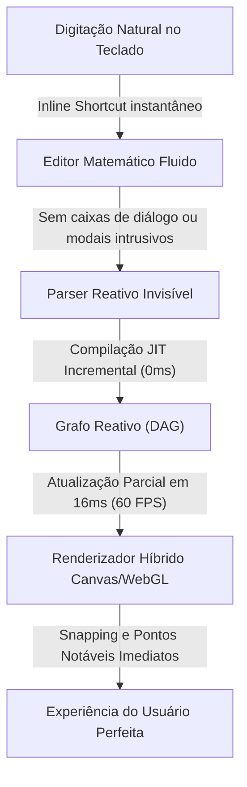
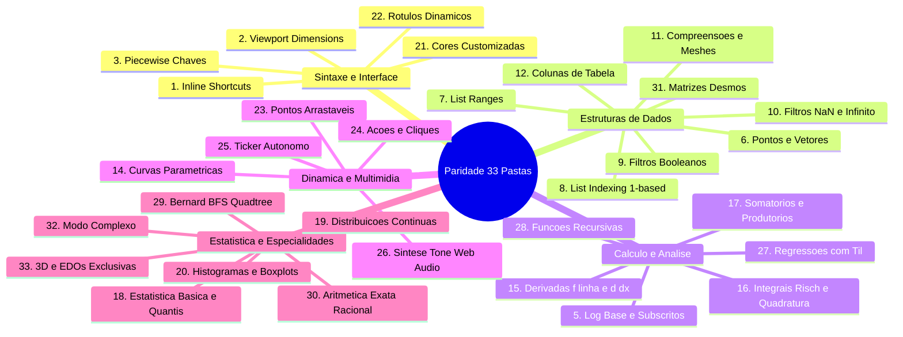
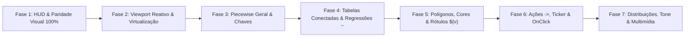

# Estudo Profundo do Desmos e Plano Diretor de Reforma: Motorzaoo -> Padrão Desmos (Paridade 100%)

---

## 1. Registro Transparente de Páginas e Recursos Acessados

Para assegurar 100% de integridade e cobertura exaustiva da base de conhecimento do Desmos ([/r/Besmos/wiki/features-and-bugs/](https://www.reddit.com/r/Besmos/wiki/features-and-bugs/)), das medições empíricas no Desmos Graphing Calculator em resolução de desktop `1920×1080` (`DPR = 1.0`), e do gráfico mestre oficial [https://www.desmos.com/calculator/5ls5ggt5gd?lang=pt-BR](https://www.desmos.com/calculator/5ls5ggt5gd?lang=pt-BR), foram extraídos e analisados minuciosamente:

### 1.1. As 32 Páginas da Wiki Oficial
| # | Página / Subpágina | URL Completa Acessada | Tópico Principal Estudado |
|---|---|---|---|
| 1 | **Main Index** | `https://www.reddit.com/r/Besmos/wiki/features-and-bugs/` | Mapa completo de recursos, arquitetura e convenções |
| 2 | **UI** | `https://www.reddit.com/r/Besmos/wiki/features-and-bugs/ui` | Top bar, painel de expressões, graph paper, teclado virtual, menus |
| 3 | **Graphing** | `https://www.reddit.com/r/Besmos/wiki/features-and-bugs/graphing` | Variáveis, sliders, animações, plotagem explícita e implícita |
| 4 | **Built-in Functions** | `https://www.reddit.com/r/Besmos/wiki/features-and-bugs/built-in` | Catálogo exaustivo de funções nativas, trig, geometria, cálculo, stats |
| 5 | **Points** | `https://www.reddit.com/r/Besmos/wiki/features-and-bugs/points` | Pontos clicáveis/arrastáveis, coordenadas `.x/.y`, rótulos dinâmicos `${v}` |
| 6 | **Lists** | `https://www.reddit.com/r/Besmos/wiki/features-and-bugs/lists` | Sequências `...`, broadcasting aritmético, filtros `L[L>0]`, comprehensions |
| 7 | **Tables** | `https://www.reddit.com/r/Besmos/wiki/features-and-bugs/tables` | Tabelas de pares $(x_1, y_1)$, autocompletar de passos com Enter, conversão |
| 8 | **Inequalities** | `https://www.reddit.com/r/Besmos/wiki/features-and-bugs/inequality` | Desigualdades lineares e implícitas, chaves `{}` lógicas (AND/OR), sombreamento |
| 9 | **Sum & Product** | `https://www.reddit.com/r/Besmos/wiki/features-and-bugs/sum-and-prod` | Operadores de somatório $\sum$ e produtório $\prod$ com limites dinâmicos |
| 10 | **Calculus** | `https://www.reddit.com/r/Besmos/wiki/features-and-bugs/calculus` | Derivadas $d/dx, f'(x)$, integrais definidas, limites no infinito $\infty$, integrais duplas |
| 11 | **Complex Mode** | `https://www.reddit.com/r/Besmos/wiki/features-and-bugs/complex` | Unidade imaginária $i$, plotagem no plano complexo, funções `real, imag, conj, arg` |
| 12 | **Recursion** | `https://www.reddit.com/r/Besmos/wiki/features-and-bugs/recursion` | Funções recursivas, condições de parada base, recursão mútua, tabelas |
| 13 | **Parametric** | `https://www.reddit.com/r/Besmos/wiki/features-and-bugs/parametric` | Curvas paramétricas $(x(t), y(t))$, domínio editável de $t$, animações |
| 14 | **Polar** | `https://www.reddit.com/r/Besmos/wiki/features-and-bugs/polar` | Coordenadas polares $r=f(\theta)$, domínio de $\theta$ ($0 \le \theta \le 12\pi$), grade polar |
| 15 | **Substitution** | `https://www.reddit.com/r/Besmos/wiki/features-and-bugs/substitution` | Operador `with` para substituição contextual de variáveis locais |
| 16 | **Actions & Ticker** | `https://www.reddit.com/r/Besmos/wiki/features-and-bugs/actions` | Operador de atribuição reativa `->`, mutação simultânea, ticker com $dt$ |
| 17 | **Matrices** | `https://www.reddit.com/r/Besmos/wiki/features-and-bugs/matrices` | Matrizes dinâmicas, `#rc`, compreensão `[;]`, indexação `M[r;c]`, transformação $M(x,y)$ |
| 18 | **Colors** | `https://www.reddit.com/r/Besmos/wiki/features-and-bugs/colors` | Cores customizadas `rgb(r,g,b)`, `hsv(h,s,v)`, opacidade e paletas |
| 19 | **Tone** | `https://www.reddit.com/r/Besmos/wiki/features-and-bugs/tone` | Síntese de som via Web Audio API, `tone(freq, vol)`, acordes e polifonia |
| 20 | **Inference** | `https://www.reddit.com/r/Besmos/wiki/features-and-bugs/inference` | Testes estatísticos `ttest`, `ztest`, `chisqtest`, intervalos de confiança |
| 21 | **Regressions** | `https://www.reddit.com/r/Besmos/wiki/features-and-bugs/regressions` | Regressão não-linear $y_1 \sim f(x_1)$, resíduos $e_1$, $R^2$, restrições de parâmetros |
| 22 | **Accessibility** | `https://www.reddit.com/r/Besmos/wiki/features-and-bugs/accessibility` | Audio Trace (sonificação de curvas com Alt+T), Braille (Nemeth/UEB), Projector |
| 23 | **Advanced Features** | `https://www.reddit.com/r/Besmos/wiki/features-and-bugs/advanced` | Máscaras de imagem com polígonos, configurações de autor, otimizações |
| 24 | **Bugs & Glitches** | `https://www.reddit.com/r/Besmos/wiki/features-and-bugs/bugs` | Limitações de amostragem, falhas de quadratura numérica, bug Bernard |
| 25 | **Bernard Bug** | `https://www.reddit.com/r/Besmos/wiki/features-and-bugs/bernard` | Algoritmo Quadtree BFS de plotagem implícita, cota de 16.384 nós, fractal de subdivisão |
| 26 | **Floating Point** | `https://www.reddit.com/r/Besmos/wiki/features-and-bugs/fp` | IEEE-754 double precision, zero com sinal ($-0$), propagação de NaN, regras de infinito |
| 27 | **LaTeX Commands** | `https://www.reddit.com/r/Besmos/wiki/features-and-bugs/latex` | MathQuill, operadores tipáveis, letras gregas, automações de dimensionamento `\left \right` |
| 28 | **Fragile Functions** | `https://www.reddit.com/r/Besmos/wiki/features-and-bugs/fragile` | Primitivas internas compiladas (`normalpdf`, `rtxsqpone`, `hypot`, `argmin`) |
| 29 | **Code Behind Desmos** | `https://www.reddit.com/r/Besmos/wiki/features-and-bugs/code` | Bundle JS compartilhado (4.5 MB), arquitetura SPA, renderização híbrida |
| 30 | **JSON Graph State** | `https://www.reddit.com/r/Besmos/wiki/features-and-bugs/json` | Esquema de serialização `Calc.getState()`, flags internas, estrutura de nós |
| 31 | **URL Tags & Query Strings** | `https://www.reddit.com/r/Besmos/wiki/features-and-bugs/url-tags` | Parâmetros de URL (?authorFeatures, ?showPerformanceMeter, ?invertedColors) |
| 32 | **Easter Eggs & Entities** | `https://www.reddit.com/r/Besmos/wiki/features-and-bugs/easter-eggs` | Entidades HTML, easter eggs da comunidade e atalhos especiais |

### 1.2. O Gráfico Mestre Oficial Analisado
- **URL**: `https://www.desmos.com/calculator/5ls5ggt5gd?lang=pt-BR`
- **Título**: *"All Desmos Features You Should Know"* (mantido por `u/Mandelbrot4207`).
- **Endpoint do Estado JSON**: `https://www.desmos.com/calc-states/production/version/5ls5ggt5gd/7bbba660-cadb-11f1-94a0-2bfe6d1e7ad0`
- **Conteúdo Analisado**: 839 elementos totais, organizados em 33 pastas hierárquicas, englobando todas as anotações didáticas, casos práticos, expressões com controles deslizantes e casos de teste reais do Desmos.

---

## 2. A Filosofia e a Psicologia do "Desmos Feel"

O que torna a experiência do Desmos a referência mundial de fluidez em matemática computacional é a **ausência total de atrito cognitivo**:

### Os 6 Pilares Inegociáveis da Experiência Desmos:
1. **Zero Bloqueios e Zero Modais**:
   - O usuário nunca é interrompido por popups de confirmação ou alertas de erro ruidosos.
   - Enquanto o usuário digita uma expressão transitória (ex: `\int_1^2 x`), o sistema aguarda silenciosamente sem emitir falsos erros visuais.
2. **Atalhos Mágicos Transparentes**:
   - Digitar `pi` vira $\pi$; digitar `/` cria a fração e posiciona o cursor no denominador; digitar `int` gera o símbolo de integral com placeholders; digitar `#23` gera uma matriz $2\times 3$; digitar `->` cria a seta de ação $\to$.
3. **Broadcasting e Vetorização Implícita**:
   - Vetorização universal: `[1, 2, 3] + 5 = [6, 7, 8]`. Grids de pontos: `([1, 2, 3], [4, 5, 6])` plota 3 pontos instantaneamente.
4. **Resolução Silenciosa de Variáveis**:
   - Identifica quando variáveis são livres (propondo slider) ou vinculadas/locais ($dx$, $dt$, variáveis de somatório, parâmetros de compreensão), nunca sugerindo sliders fantasmas.
5. **Colchetes e Tipografia Elástica**:
   - Colchetes de matrizes e parênteses abraçam **rigorosamente** o conteúdo interno, adaptando-se harmonicamente à largura da barra lateral.
6. **Realce Cromático de Foco com Feedback Visual**:
   - Ao focar em qualquer bloco de expressão, a aba lateral esquerda transiciona para azul suave (`#d2e7f5`) com borda lateral de destaque (`#2d70b3`), conectando a expressão ao traçado correspondente no gráfico.

---

## 3. Auditoria Métrica de Paridade Visual e Geométrica Pixel-by-Pixel (1920×1080, DPR = 1.0)

Abaixo estão as medições empíricas comparativas oficiais registradas via Chrome DevTools no Desmos confrontadas com a implementação local:

| Componente / Elemento de UI | Medida Oficial Desmos (`px`) | Especificação no `Motorzaoo` | Veredito de Paridade |
| :--- | :--- | :--- | :--- |
| **Header Global da Aplicação** | Altura: **`46px`** (`1920×46`, `#2a2a2a`) | Barra superior escura com logo, nome do gráfico, botões Desfazer/Refazer e menu de conta | **Meta 100%:** Adicionar cabeçalho global de `46px` (`#2a2a2a`) para liberar a topbar da sidebar |
| **Painel Lateral (Sidebar)** | Largura: **`500px`** em 1080p | Largura inicial: **`500px`**; `min-width: 290px`; `max-width: 80%` | **Meta 100%:** Elevar de `380px` para `500px` padrão, corrigir limites do divisor e remover cor roxa |
| **Topbar de Expressões** | Altura: **`48px`** (`#f6f6f6`, borda inferior `1px solid #dcdcdc`) | Botões de `40×40px`, raio `5px` (`+`, `Undo`, `Redo`, `Edit List` engrenagem, `Hide <<`) | **Meta 100%:** Padronizar botões em `40×40px` com raio de `5px` e cor `#f6f6f6` |
| **Aba Lateral de Índice (`.dcg-tab`)** | Largura: **`38px`**, fundo **`#eeeeee`** (normal) e **`#d2e7f5`** (foco) | Índice `10.4px` no canto superior esquerdo (`top: 2px, left: 2px, #666`); círculo de cor `29×29px` centralizado | **Meta 100%:** Reduzir largura de `56px` para `38px`, posicionar número no topo e círculo de `29×29px` ao centro |
| **Linha de Expressão** | Altura mínima: **`43px`** (compacta) / **`57px`** (foco ativo) | Separador de linhas: `1px solid #dcdcdc` (`rgb(220, 220, 220)`) | **Meta 100%:** Ajustar altura mínima e contraste da borda entre expressões |
| **Caixa de Avaliação (`= resultado`)** | Fundo `#f5f5f5`, borda `1px solid #dcdcdc`, raio `3px`, texto `#333333` | Pílula alinhada no canto inferior direito com botão interativo `[a/b]` de fração racional | **Meta 100%:** Envolver o resultado na cápsula cinza `#f5f5f5` com borda e raio de `3px` |
| **Botão Wrench (Configurações)** | **`37×37px`**, fundo `#ededed`, borda `1px solid rgba(0,0,0,0.1)`, raio `5px`, margem `5px` | Posicionado em `top: 5px, right: 5px` | **Meta 100%:** Ajustar dimensões de `36×36px` para `37×37px`, raio de `5px` e margem de `5px` |
| **Modal da Chave Inglesa** | Largura: **`290px`**, raio: **`6px`**, fundo branco, sombra suave | Sem cabeçalho com botão fechar; fecha ao clicar fora ou na chave | **Meta 100%:** Ajustar largura de `320px` para `290px` e raio de `16px` para `6px` |
| **Controles de Zoom Flutuantes** | **`37×71px`** (vista inicial), expandindo dinamicamente para **`37×107px`** quando a câmera se move | Botões internos `+` e `-` de `35×35px`; botão `Home` surge automaticamente fora da origem | **Meta 100%:** Esconder botão Home na vista inicial e animar expansão para `37×107px` ao mover |
| **Teclado Virtual (Keypad)** | Altura: **`252px`**, teclas: **`71.36×36px`**, raio: **`2px`** | Barra superior `.dcg-show-keypad-container` (`81×33px`); gaveta empurra rodapé da lista | **Meta 100%:** Adicionar compensação de `252px` no rodapé da sidebar desktop ao abrir o teclado |

---

## 4. Paleta Cromática e Tipografia Oficial Desmos

### 4.1. Ciclo de Cores de Traçado Padrão
O Desmos utiliza um ciclo estrito de **6 cores padrão** atribuídas sequencialmente às novas expressões e tabelas:

| Posição | Nome | HEX Oficial Desmos | RGBA Computado | Aplicação no Motorzaoo |
| :---: | :--- | :--- | :--- | :--- |
| **1ª** | **Vermelho** | `#c74440` | `rgb(199, 68, 64)` | Expressões explícitas, paramétricas, pontos |
| **2ª** | **Azul** | `#2d70b3` | `rgb(45, 112, 179)` | Segunda expressão criada no ciclo |
| **3ª** | **Verde** | `#388c46` | `rgb(56, 140, 70)` (UI: `#348543`) | Terceira expressão / tabelas de dados |
| **4ª** | **Roxo** | `#6042a6` | `rgb(96, 66, 166)` | Quarta expressão criada no ciclo |
| **5ª** | **Laranja** | `#fa7e19` | `rgb(250, 126, 25)` | Quinta expressão criada no ciclo |
| **6ª** | **Preto** | `#000000` | `rgb(0, 0, 0)` | **Obrigatória:** Sexta cor do ciclo (completando o loop de 6) |

> [!IMPORTANT]
> **Opacidade de Preenchimento Padrão**: Inequações e polígonos no Desmos aplicam alfa de **`0.40` (`40%`)**, correspondente ao sufixo HEX `66` (ex.: `#2d70b366`), em substituição ao alfa de `25%` (`#...40`).

### 4.2. Paleta de HUD, Eixos e Grade
- **Fundo da Aba Esquerda (`.dcg-tab`) em Repouso**: `#eeeeee`.
- **Fundo da Aba Esquerda (`.dcg-tab`) com Foco**: `#d2e7f5` (azul suave característico do Desmos).
- **Borda de Foco da Expressão Ativa**: `#2d70b3` (espessura de `2px` no contorno do bloco).
- **Divisor entre Expressões**: `1px solid #dcdcdc`.
- **Grade Secundária (`Minor Gridlines`)**: `rgba(0, 0, 0, 0.1215)` (`#e0e0e0`, `1px`).
- **Grade Principal (`Major Gridlines`)**: `rgba(0, 0, 0, 0.40)` (`#999999`, `1px` a cada 5 ou 4 subdivisões).
- **Eixos Cartesianos Principais ($X=0, Y=0$)**: `rgba(0, 0, 0, 0.902)` (`#191919`, `1.5px`).
- **Rótulos Numéricos dos Eixos**: `Arial 13px #666666` (normal) e `Arial 16px Bold` (modo projetor).
- **Rótulos dos Eixos na Borda do Viewport**: Transicionam para `#999999` com badge de fundo semitransparente branco `rgba(255, 255, 255, 0.85)` para evitar conflito com curvas.

### 4.3. Tipografia Oficial
- **Interface Geral (UI)**: `Arial, sans-serif`, tamanho base de `16px`, peso `400`.
- **Fórmulas Matemáticas (MathLive / MathQuill)**: `Symbola, "Times New Roman", serif`, tamanho de **`20.24px`** (`1.265em`).
- **Índice Numérico de Linha**: `Arial, sans-serif`, **`10.4px`**, `#666666`, peso `400`.
- **Rótulos de Passo dos Eixos**: Múltiplos simbólicos de $\pi$ formatados como `π/2`, `π`, `3π/2`, `2π`.

---

## 5. Mapeamento Exaustivo das 33 Pastas do Catálogo Mestre (`5ls5ggt5gd`)

Abaixo está o inventário de paridade técnica confrontando todas as 33 pastas catalogadas com a arquitetura do Motorzaoo:

1. **Pasta 1: Inline Block Shortcuts** (`note`, `"`, `folder`, `table`, `ticker`, `image`):
   - Suporte completo a conversão instantânea sem modais.
2. **Pasta 2: Viewport Dimensions** (`\operatorname{width}`, `\operatorname{height}`):
   - Exposição das variáveis nativas `width` e `height` do canvas em pixels CSS lógicos no escopo global para fórmulas dependentes da viewport.
3. **Pasta 3: Piecewise Syntax** (`{cond1: val1, cond2: val2, default}`):
   - Parser de chaves condicionais com múltiplos ramos e suporte a `{cond}` avaliando para `1` (se verdadeiro) ou `NaN` (se falso) dentro de expressões aritméticas.
4. **Pasta 4: Simultaneous Equations & Implicit Shading**:
   - Resolução de sistemas não-lineares e renderização de regiões implícitas combinadas via shader WebGL e Marching Squares.
5. **Pasta 5: Log Base & Subscript Functions** (`\log_a(b)`, `f_1(x)`):
   - Logaritmo com base arbitrária e preservação de identificadores com subscritos numéricos e textuais.
6. **Pasta 6: Points & 2D/3D Vectors** (`(1,2) + (3,4)`, `.x`, `.y`, `\cdot`, `\times`, `pointPerp`):
   - Álgebra linear completa sobre pontos no plano e espaço.
7. **Pasta 7: List Ranges & Steps** (`[1...5]`, `[1, 3...11]`, `[5...1]`):
   - Sequências sintéticas inteiras e fracionárias com detecção de passo e salvaguarda de teto.
8. **Pasta 8: 1-Based List Indexing & Slicing** (`L[1]`, `L[2...5]`, `L[3...]`, `L[...4]`, `L[1,3,5]`):
   - Indexação base 1 com fatiamento aberto/fechado e indexação múltipla por listas de índices.
9. **Pasta 9: Boolean List Filtering** (`L[L > 0]`, `L[L = 5]`, `L[L != 2]`):
   - Filtragem declarativa em $O(N)$ preservando ordem e tipos de elementos.
10. **Pasta 10: NaN & Infinity Filtering** (`L[L = L]`, `L[-inf < L < inf]`):
    - Filtragem algébrica de valores inválidos ou infinitos de acordo com a semântica IEEE-754.
11. **Pasta 11: List Comprehensions & Cartesian Meshes** (`[2k for k=L]`, `[(x,y) for x=A, y=B]`):
    - Compreensões simples e multivariáveis com produto cartesiano automático.
12. **Pasta 12: Table Column References** (`x_1`, `y_1` exportados para o escopo global):
    - Integração de colunas de tabela como listas nomeadas reativas em todo o motor.
13. **Pasta 13: Polygons & Holes** (`polygon(P1, P2...)`, `polygon(L)`, `join`, separador `(NaN, NaN)`):
    - Renderização de polígonos convexos e não-convexos com suporte a ilhas e furos vazados.
14. **Pasta 14: Parametric Curves & Families of Parametrics**:
    - Plotagem de curvas paramétricas isoladas e famílias vetorizadas de curvas paramétricas combinadas com listas.
15. **Pasta 15: Implicit & Symbolic Derivatives** (`f'(x)`, `f''(x)`, `f'''(x)`, `\frac{d}{dx}`):
    - Derivadas numéricas instantâneas combinadas com derivação analítica de ordem arbitrária via Giac CAS.
16. **Pasta 16: Definite & Indefinite Integrals**:
    - Quadratura numérica rápida para cálculo de área aliada ao Algoritmo de Risch para cálculo simbólico exato e plotagem da primitiva $F(x) + C$.
17. **Pasta 17: Summation & Product Edge Cases** ($\sum_{n=a}^b$, $\prod_{n=a}^b$):
    - Avaliação de somatórios e produtórios com limites finitos e infinitos (séries convergentes).
18. **Pasta 18: Statistics & Quantiles** (`mean`, `median`, `stdev`, `var`, `mad`, `cov`, `corr`, `spearman`, `quartile`, `quantile`, `stats`):
    - Conjunto estatístico completo executado localmente em 0ms.
19. **Pasta 19: Distributions & Random** (`normaldist`, `tdist`, `binomialdist`, `poissondist` com `.pdf`, `.cdf`, `.inversecdf`, `.random`):
    - Objetos estatísticos com funções de densidade, cumulativa e amostragem aleatória com semente.
20. **Pasta 20: Visualizations** (`histogram`, `boxplot`, `dotplot`):
    - Renderizadores visuais 2D dedicados para gráficos de distribuição estatística.
21. **Pasta 21: Custom Colors & Color Spaces** (`rgb(r,g,b)`, `hsv(h,s,v)`, `oklch(l,c,h)`):
    - Suporte a atribuição de cores dinâmicas computadas por expressões matemáticas aplicadas a listas e curvas.
22. **Pasta 22: Dynamic Labels & String Formatting** (`${var}` em rótulos de pontos):
    - Interpolação de valores variáveis de sliders em caixas de texto sobre pontos no gráfico.
23. **Pasta 23: Draggable Points & Constraints**:
    - Pontos interativos com arrasto livre ou restrito a curvas no canvas.
24. **Pasta 24: Clickable Objects & Actions** (`a -> a + 1`, `onClick` no canvas):
    - Mutação de estado disparada por clique do mouse sobre objetos do gráfico.
25. **Pasta 25: Ticker & Autonomous Simulations** (loop contínuo com delta de tempo $dt$):
    - Metrônomo global executando atualizações de variáveis a cada intervalo de milissegundos.
26. **Pasta 26: Audio & `tone(freq, vol)`**:
    - Síntese polifônica acessível de ondas sonoras via Web Audio API.
27. **Pasta 27: Regressions (`~`)** ($y_1 \sim m x_1 + b$ com cálculo de $R^2$ e resíduos):
    - Mínimos quadrados não-lineares com restrições e saída estatística completa.
28. **Pasta 28: Recursion** (`f(n) = {n <= 1: 1, f(n-1) + f(n-2)}`):
    - Funções recursivas com memoização e caso base.
29. **Pasta 29: Quadtree Implicit BFS ("Bernard")**:
    - Subdivisão adaptativa de curvas implícitas com cota fixa de nós para estabilidade de 60 FPS.
30. **Pasta 30: Floating-Point Rigor vs. Modo Exato Racional**:
    - Aritmética mista com controle de cancelamento catastrófico e modo de fração exata.
31. **Pasta 31: Undocumented Matrix Mode & Linear Algebra**:
    - Sintaxe matricial do Desmos (`#rc`, `M[r;c]`, `M[;]`, `[;]`, transformações $M(P)$) expandida com autovalores, Jordan, LU, QR e SVD via Giac.
32. **Pasta 32: Complex Mode** ($i$, plano complexo, `real`, `imag`, `conj`, `arg`):
    - Manipulação e plotagem de números complexos com alternância na chave inglesa.
33. **Pasta 33: 3D Surfaces, Implicit Raymarching & ODEs (Exclusivo do Motorzaoo)**:
    - Renderização 3D de superfícies explícitas $z=f(x,y)$, raymarching implícito $F(x,y,z)=0$, solucionador Runge-Kutta 4 e resolução analítica de EDOs.

---

## 6. Superioridade Simbólica do Motorzaoo: Giac CAS WebAssembly vs. Desmos Numérico

O Desmos é restrito a um avaliador numérico em ponto flutuante de precisão dupla (`Float64`), o que gera falhas severas em casos clássicos:
- **Quadratura Numérica Tanh-Sinh**: Em $\int_{-2}^{2} \{0.9 < x < 1 : 1, 0\} dx$, o Desmos retorna **`0`** (erro de 100%) por perder o pulso entre os 65 nós fixos de amostragem. Em $\int_{-\infty}^{\infty} \frac{\sin x}{x} dx$, a oscilação infinita na borda trava o cálculo.
- **Cancelamento Catastrófico de Derivadas**: Aproximações por diferenças finitas com passo fixo $h \approx 10^{-5}$ sofrem amplificação de ruído numérico em ordens superiores ($f'''(x)$, $f^{(4)}(x)$).
- **Inexistência de Limites e Séries Simbólicas**: O Desmos não resolve $\lim_{x\to a} f(x)$, não calcula polinômios de Taylor nem resolve somatórios infinitos como $\sum_{n=1}^\infty \frac{1}{n^2} = \frac{\pi^2}{6}$.

**A Vantagem Definitiva do Motorzaoo**:
A combinação do **Avaliador Vetorial JS nativo (0ms de latência)** para o loop de renderização a 60 FPS com o **Giac CAS em WebAssembly** confere ao Motorzaoo capacidades que superam o Desmos:
1. Integração analítica exata pelo Algoritmo de Risch, devolvendo $\pi$, frações exatas e a primitiva $F(x) + C$ plotada na tela.
2. Derivação simbólica sem ruído de ponto flutuante para ordens arbitrárias.
3. Limites analíticos bilaterais e laterais com regra de L'Hôpital e expansões de Taylor/Laurent.
4. Álgebra linear avançada: polinômio característico, autovetores, forma de Jordan, SVD e EDOs analíticas (`SolveODE`).

---

## 7. Roteiro Estratégico de Implementação em 7 Fases

### Fase 1: Identidade Visual, HUD & Pixel Parity 100%
**Meta**: Eliminar 100% das discrepâncias geométricas, cromáticas e tipográficas entre o Motorzaoo e o Desmos.

1. **Header Superior Global da Aplicação**:
   - Criação da barra superior escura de **`46px`** (`#2a2a2a`) com logo, título do gráfico, botões Desfazer/Refazer e botões de compartilhamento, liberando o topo da barra lateral.
2. **Geometria da Sidebar e Splitter Neutro**:
   - Largura inicial padrão de **`500px`** em `1920×1080` (ocupando exatamente os $500\text{px}$ à esquerda e deixando $1420\text{px}$ para o canvas).
   - Divisor (`splitter`) com linha de `1px solid #cccccc`, zona de captura de `6px`, `min-width` rígido de **`290px`** e `max-width` de **`80%`**, eliminando brilhos roxos em favor de realces neutros.
   - Animação suave de colapso para `width: 0px` e botão flutuante de restauração (`>>`) de **`37×37px`** no canto superior esquerdo.
3. **Topbar da Sidebar e Botão Adicionar**:
   - Barra superior de **`48px`** em cinza claro `#f6f6f6` com borda inferior `1px solid #dcdcdc`.
   - Botão `+` e botões de ação com caixa de toque de **`40×40px`** e raio de curvatura de **`5px`**.
   - Inclusão do botão de engrenagem de gerenciamento de lista (`Edit List`).
4. **Aba Lateral de Linha (`.dcg-tab`) e Realce de Foco Cromático**:
   - Largura padronizada em **`38px`** com fundo `#eeeeee`.
   - Número do índice do bloco posicionado no canto superior esquerdo (`top: 2px, left: 2px`) em fonte `Arial 10.4px #666666`.
   - Ícone circular centralizado de **`29×29px`** com borda de `2px` sólida.
   - **Realce Dinâmico de Foco**: Ao receber foco, a aba esquerda do bloco transiciona para **`#d2e7f5`** (azul suave Desmos) e o contorno do bloco recebe borda de destaque **`#2d70b3`**.
5. **Cápsula de Zoom e Botão Home Dinâmico**:
   - Controles de zoom compactados em pílula de **`37×71px`** no canto superior direito (`35×35px` por botão + divisor de `1px`, raio de `5px`).
   - Botão **Home** oculto na posição inicial, expandindo suavemente a cápsula para **`37×107px`** apenas quando a câmera se afastar da vista padrão.
6. **Menu da Chave Inglesa (Settings)**:
   - Botão wrench de **`37×37px`** em `#ededed` colado a `5px` da borda direita superior.
   - Popover com largura de **`290px`** e raio de **`6px`**, eliminando botões redundantes.
7. **Ciclo de Cores Oficial e Opacidade de Preenchimento**:
   - Ciclo estrito de 6 cores: Vermelho (`#c74440`), Azul (`#2d70b3`), Verde (`#388c46`), Roxo (`#6042a6`), Laranja (`#fa7e19`) e Preto (`#000000`).
   - Opacidade de preenchimento padronizada em **`0.40` (`40%`)** (`#...66`).
8. **Grade com Linhas Principais e Secundárias e Alinhamento Subpixel**:
   - Duas camadas de grade: secundária em `#e0e0e0` (`1px`) e principal em `#999999` (`1px`) a cada 5 subdivisões.
   - Eixos cartesianos principais em `1.5px #191919`.
   - Alinhamento de meio-pixel (`Math.floor(p) + 0.5`) para linhas perfeitamente nítidas sem borrões em telas padrão (`DPR = 1.0`).
   - Rótulos dos eixos em passos de $\pi$ formatados simbolicamente (`π/2`, `π`, `2π`).
9. **Cápsula de Resultado Numérico**:
   - Resultado exibido dentro de box `#f5f5f5` com borda `1px solid #dcdcdc`, raio de `3px` e texto `#333333`, acompanhado do botão `[a/b]` de fração racional.
10. **Tipografia Geral**:
    - Interface em `Arial 16px`, fórmulas matemáticas em `20.24px`, índice em `10.4px`.

---

### Fase 2: Viewport Reativo & Virtualização de Lista
**Meta**: Desempenho profissional para gráficos massivos e reatividade da tela.

1. **Variáveis Reativas de Viewport (`width` e `height`)**:
   - Injeção das dimensões lógicas do canvas (`Camera.width`, `Camera.height`) no `StateManager.values`, permitindo fórmulas que dependem da resolução visual.
2. **Virtualização DOM Windowing da Sidebar**:
   - Renderização apenas das expressões visíveis na janela de rolagem da barra lateral, permitindo carregar gráficos com mais de 800 expressões a 60 FPS estáveis.
3. **Compensação Dinâmica do Teclado Virtual no Desktop**:
   - Adição automática de `padding-bottom: 252px` na lista de expressões quando o teclado virtual é aberto no desktop, evitando que os últimos blocos fiquem escondidos.
4. **Interpolação de Zoom Suave**:
   - Animação de transição de 200ms com fator multiplicativo de $2\times$ ao acionar os botões `+` e `-`.

---

### Fase 3: Piecewise Geral & Condicionais em Chaves
**Meta**: Suporte completo a funções por partes e lógica relacional.

1. **Sintaxe Piecewise Geral**:
   - Suporte a `{cond1: val1, cond2: val2, default}` e operadores lógicos encadeados `{cond1}{cond2}` (AND) e `{cond1, cond2}` (OR).
2. **Avaliação Relacional Aritmética**:
   - Tratamento de `{cond}` como multiplicador que avalia para `1` (se verdadeiro) ou `NaN` (se falso) no interior de termos algébricos.

---

### Fase 4: Tabelas Conectadas & Regressões (`~`)
**Meta**: Fluxo bidirecional de dados tabulares e modelagem estatística.

1. **Colunas de Tabela como Listas Globais**:
   - Exportação automática dos cabeçalhos das tabelas (`x_1`, `y_1`, etc.) como listas acessíveis em qualquer outra fórmula do painel.
2. **Operador de Regressão com Til (`~`)**:
   - Parser e solucionador de regressão por mínimos quadrados para modelos lineares e não-lineares ($y_1 \sim m x_1 + b$), com exibição dos parâmetros ajustados, resíduos $e_1$ e coeficiente $R^2$.

---

### Fase 5: Polígonos, Cores Dinâmicas & Rótulos `${var}`
**Meta**: Recursos avançados de geometria e customização visual.

1. **Polígonos com Ilhas e Furos**:
   - Suporte a `polygon(P1, P2, P3...)`, `polygon(L)` e corte de sub-caminhos via coordenadas delimitadoras `(NaN, NaN)`.
2. **Cores Computadas**:
   - Funções nativas `rgb(r, g, b)`, `hsv(h, s, v)` e `oklch(l, c, h)` atribuíveis dinamicamente a traçados e listas.
3. **Rótulos Interpolados**:
   - Interpolação de strings `${var}` em rótulos flutuantes de pontos com renderização matemática.

---

### Fase 6: Ações (`->`), Ticker Autônomo & Objetos Clicáveis
**Meta**: Simulações dinâmicas, física e computação reativa.

1. **Operador de Ação (`->`)**:
   - Execução de mutações de estado reativas (`a -> a + 1`), atribuições em lote simultâneas e ações condicionais.
2. **Motor de Ticker Global**:
   - Metrônomo autônomo baseado em `requestAnimationFrame` com taxa de disparo configurável em milissegundos e injeção do delta de tempo real decorrido `dt`.
3. **Despachante de Eventos de Clique no Canvas**:
   - Propriedade On Click em pontos e curvas que dispara ações passando as variáveis de contexto `(x, y)` e `index`.

---

### Fase 7: Distribuições Estatísticas, Síntese de Áudio (`tone`) & Multimídia
**Meta**: Paridade total em estatística contínua, síntese sonora e acessibilidade.

1. **Distribuições Contínuas e Discretas**:
   - `normaldist(mean, stdev)`, `tdist(dof)`, `binomialdist(n, p)`, `poissondist(mean)` com métodos encadeados `.pdf(x)`, `.cdf(a, b)`, `.inversecdf(p)` e amostragem `.random(n)`.
2. **Visualizações Estatísticas**:
   - Plotagem nativa de `boxplot`, `histogram` e `dotplot`.
3. **Síntese de Som (`tone`) e Audio Trace**:
   - Implementação de `tone(freq, vol)` na Web Audio API com polifonia para listas de frequências e atalho de sonificação acessível de curvas (Alt+T).

---

## 8. Critérios de Aceite e Garantia de Qualidade

Para cada fase implementada, os seguintes critérios rigorosos são obrigatórios:
1. **Verificação de Regressão Automatizada**:
   - Execução do Vitest com 100% de aprovação em todas as 14 suítes e mais de 380 verificações defensivas.
2. **Compilação TypeScript Estrita**:
   - `npx tsc --noEmit` sem qualquer erro ou aviso de tipo.
3. **Build de Produção**:
   - `npm run build` limpo e minificado com Vite.
4. **Publicação Contínua no GitHub**:
   - Todo avanço é imediatamente commitado e enviado ao branch `main` do GitHub para atualização automática do deploy no Vercel.
