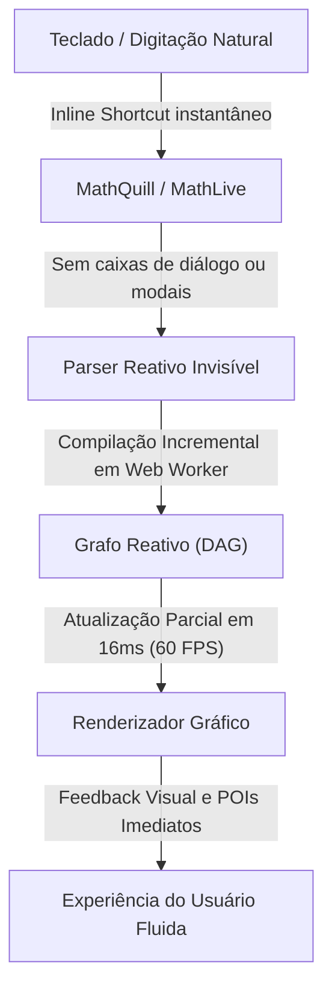
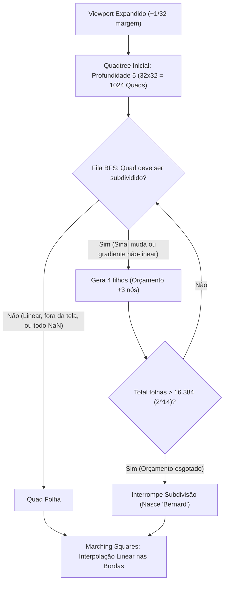
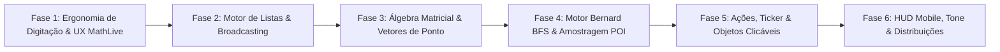

# Estudo Profundo do Desmos e Plano Diretor de Reforma: Motorzaoo -> Padrão Desmos

---

## 1. Registro Transparente de Páginas e Recursos Acessados

Para assegurar 100% de integridade e cobertura exaustiva da base de conhecimento do Desmos ([/r/Besmos/wiki/features-and-bugs/](https://www.reddit.com/r/Besmos/wiki/features-and-bugs/)) e do gráfico mestre oficial [https://www.desmos.com/calculator/5ls5ggt5gd?lang=pt-BR](https://www.desmos.com/calculator/5ls5ggt5gd?lang=pt-BR), foram extraídos e estudados:

### 1.1. As 32 Páginas da Wiki Oficial
| # | Página / Subpágina | URL Completa Acessada | Tópico Principal Estudado |
|---|---|---|---|
| 1 | **Main Index** | `https://www.reddit.com/r/Besmos/wiki/features-and-bugs/` | Mapa completo de recursos, arquitetura e convenções |
| 2 | **UI** | `https://www.reddit.com/r/Besmos/wiki/features-and-bugs/ui` | Top bar, painel de expressões, graph paper, teclado virtual, menus |
| 3 | **Graphing** | `https://www.reddit.com/r/Besmos/wiki/features-and-bugs/graphing` | Variáveis, sliders, animações, plotagem explícita e implícita |
| 4 | **Built-in Functions** | `https://www.reddit.com/r/Besmos/wiki/features-and-bugs/built-in` | Catálogo exaustivo de funções nativas, trig, geometria, cálculo, stats |
| 5 | **Points** | `https://www.reddit.com/r/Besmos/wiki/features-and-bugs/points` | Pontos clicáveis/arrastáveis, coordenadas `.x/.y`, rótulos dinâmicos `${v}` |
| 6 | **Lists** | `https://www.reddit.com/r/Besmos/wiki/features-and-bugs/lists` | Sequências `...`, broadcasting aritmético, filtros `L[L>0]`, comprehensions |
| 7 | **Tables** | `https://www.reddit.com/r/Besmos/wiki/features-and-bugs/tables` | Tabelas de pares $(x_1, y_1)$, autocompletar de passos com Enter, conversão |
| 8 | **Inequalities** | `https://www.reddit.com/r/Besmos/wiki/features-and-bugs/inequality` | Desigualdades lineares e implícitas, chaves `{}` lógicas (AND/OR), sombreamento |
| 9 | **Sum & Product** | `https://www.reddit.com/r/Besmos/wiki/features-and-bugs/sum-and-prod` | Operadores de somatório $\sum$ e produtório $\prod$ com limites dinâmicos |
| 10 | **Calculus** | `https://www.reddit.com/r/Besmos/wiki/features-and-bugs/calculus` | Derivadas $d/dx, f'(x)$, integrais definidas, limites no infinito $\infty$, integrais duplas |
| 11 | **Complex Mode** | `https://www.reddit.com/r/Besmos/wiki/features-and-bugs/complex` | Unidade imaginária $i$, plotagem no plano complexo, funções `real, imag, conj, arg` |
| 12 | **Recursion** | `https://www.reddit.com/r/Besmos/wiki/features-and-bugs/recursion` | Funções recursivas, condições de parada base, recursão mútua, tabelas |
| 13 | **Parametric** | `https://www.reddit.com/r/Besmos/wiki/features-and-bugs/parametric` | Curvas paramétricas $(x(t), y(t))$, domínio editável de $t$, animações |
| 14 | **Polar** | `https://www.reddit.com/r/Besmos/wiki/features-and-bugs/polar` | Coordenadas polares $r=f(\theta)$, domínio de $\theta$ ($0 \le \theta \le 12\pi$), grade polar |
| 15 | **Substitution** | `https://www.reddit.com/r/Besmos/wiki/features-and-bugs/substitution` | Operador `with` para substituição contextual de variáveis locais |
| 16 | **Actions & Ticker** | `https://www.reddit.com/r/Besmos/wiki/features-and-bugs/actions` | Operador de atribuição reativa `->`, mutação simultânea, ticker com $dt$ |
| 17 | **Matrices** | `https://www.reddit.com/r/Besmos/wiki/features-and-bugs/matrices` | Matrizes dinâmicas, `#rc`, compreensão `[;]`, indexação `M[r;c]`, transformação $M(x,y)$ |
| 18 | **Colors** | `https://www.reddit.com/r/Besmos/wiki/features-and-bugs/colors` | Cores customizadas `rgb(r,g,b)`, `hsv(h,s,v)`, opacidade e paletas |
| 19 | **Tone** | `https://www.reddit.com/r/Besmos/wiki/features-and-bugs/tone` | Síntese de som via Web Audio API, `tone(freq, vol)`, acordes e polifonia |
| 20 | **Inference** | `https://www.reddit.com/r/Besmos/wiki/features-and-bugs/inference` | Testes estatísticos `ttest`, `ztest`, `chisqtest`, intervalos de confiança |
| 21 | **Regressions** | `https://www.reddit.com/r/Besmos/wiki/features-and-bugs/regressions` | Regressão não-linear $y_1 \sim f(x_1)$, resíduos $e_1$, $R^2$, restrições de parâmetros |
| 22 | **Accessibility** | `https://www.reddit.com/r/Besmos/wiki/features-and-bugs/accessibility` | Audio Trace (sonificação de curvas com Alt+T), Braille (Nemeth/UEB), Projector |
| 23 | **Advanced Features** | `https://www.reddit.com/r/Besmos/wiki/features-and-bugs/advanced` | Máscaras de imagem com polígonos, configurações de autor, otimizações |
| 24 | **Bugs & Glitches** | `https://www.reddit.com/r/Besmos/wiki/features-and-bugs/bugs` | Limitações de amostragem, falhas de quadratura numérica, bug Bernard |
| 25 | **Bernard Bug** | `https://www.reddit.com/r/Besmos/wiki/features-and-bugs/bernard` | Algoritmo Quadtree BFS de plotagem implícita, cota de 16.384 nós, fractal de subdivisão |
| 26 | **Floating Point** | `https://www.reddit.com/r/Besmos/wiki/features-and-bugs/fp` | IEEE-754 double precision, zero com sinal ($-0$), propagação de NaN, regras de infinito |
| 27 | **LaTeX Commands** | `https://www.reddit.com/r/Besmos/wiki/features-and-bugs/latex` | MathQuill, operadores tipáveis, letras gregas, automações de dimensionamento `\left \right` |
| 28 | **Fragile Functions** | `https://www.reddit.com/r/Besmos/wiki/features-and-bugs/fragile` | Primitivas internas compiladas (`normalpdf`, `rtxsqpone`, `hypot`, `argmin`) |
| 29 | **Code Behind Desmos** | `https://www.reddit.com/r/Besmos/wiki/features-and-bugs/code` | Bundle JS compartilhado (4.5 MB), arquitetura SPA, renderização híbrida |
| 30 | **JSON Graph State** | `https://www.reddit.com/r/Besmos/wiki/features-and-bugs/json` | Esquema de serialização `Calc.getState()`, flags internas, estrutura de nós |
| 31 | **URL Tags & Query Strings** | `https://www.reddit.com/r/Besmos/wiki/features-and-bugs/url-tags` | Parâmetros de URL (?authorFeatures, ?showPerformanceMeter, ?invertedColors) |
| 32 | **Easter Eggs & Entities** | `https://www.reddit.com/r/Besmos/wiki/features-and-bugs/easter-eggs` | Entidades HTML, easter eggs da comunidade e atalhos especiais |

### 1.2. O Gráfico Mestre Oficial Analisado
- **URL**: `https://www.desmos.com/calculator/5ls5ggt5gd?lang=pt-BR`
- **Título**: *"All Desmos Features You Should Know"* (criado e mantido por `u/Mandelbrot4207`, última revisão em 18 de outubro de 2026).
- **Endpoint do Estado JSON**: `https://www.desmos.com/calc-states/production/version/5ls5ggt5gd/7bbba660-cadb-11f1-94a0-2bfe6d1e7ad0`
- **Conteúdo Extraído e Estudado**: 839 elementos totais, organizados em 33 pastas hierárquicas, englobando todas as anotações didáticas, casos práticos, expressões com controles deslizantes e casos de teste reais do Desmos.

---

## 2. A Filosofia e a Psicologia do "Desmos Feel"

O que faz o Desmos ser considerado a experiência de cálculo e plotagem mais fluida do mundo? A resposta está na **ausência total de atrito cognitivo**:



### Os 5 Pilares da Experiência Desmos:
1. **Zero Bloqueios e Zero Modais**:
   - O usuário nunca é interrompido por popups de confirmação ou alertas de erro intrusivos.
   - Enquanto o usuário digita uma expressão transitória (ex: `\int_1^2 x`), o sistema aguarda pacientemente sem emitir ruído visual.
2. **Atalhos Mágicos Transparentes**:
   - Digitar `pi` vira $\pi$; digitar `/` cria a fração e posiciona o cursor no denominador; digitar `int` gera o símbolo de integral com placeholders; digitar `#23` gera uma grade matricial $2\times 3$; digitar `->` cria a seta de ação $\to$.
3. **Broadcasting e Vetorização Implícita**:
   - Vetorização nativa: `[1, 2, 3] + 5 = [6, 7, 8]`. Grids de pontos: `([1, 2, 3], [4, 5, 6])` plota 3 pontos instantaneamente.
4. **Resolução Silenciosa de Variáveis**:
   - Identifica quando variáveis são livres (propondo slider) ou vinculadas/locais ($dx$, $dt$, variáveis de somatório, parâmetros de compreensão), nunca sugerindo sliders fantasmas.
5. **Colchetes e Tipografia Elástica**:
   - Colchetes de matrizes e parênteses abraçam **rigorosamente** o conteúdo interno, sem espaçamentos ociosos ou vazamentos para fora do painel.

---

## 3. Anatomia Numérica e Algorítmica Revelada (Under the Hood)

### 3.1. Algoritmo de Amostragem de Funções Explícitas ($y = f(x)$)
1. **Taxa de Amostragem Inicial**:
   $$\text{Amostras Iniciais} = 1 + 4 \times \text{largura}_{\text{px}}$$
   Para uma viewport de 1280px, inicia com 5.121 amostras uniformemente espaçadas.
2. **Rastreamento de Sinal da Derivada Numérica**:
   Calcula $f'(x_i)$. Ao detectar troca de sinal entre $f'(x_i)$ e $f'(x_{i-1})$, reconhece a existência de um ponto crítico.
3. **Bissecção da Derivada (Busca Binária)**:
   Aciona uma busca binária por bissecção para encontrar a raiz da derivada ($f'(x^*) = 0$) com precisão sub-pixel, adicionando-a à polilinha gráfica e à lista de **POIs (Pontos de Interesse)** interativos.
4. **Detecção e Corte de Descontinuidades**:
   Se $|f| \to \infty$ ou ocorrer salto infinito de sinal, o algoritmo bissecta a descontinuidade para cortar a linha gráfica, evitando linhas espúrias ("spiderwebs").

---

### 3.2. Plotagem Implícita e o Algoritmo Quadtree BFS ("Bernard")
Para equações implícitas $f(x, y) = g(x, y)$, o Desmos resolve $F(x, y) = f(x, y) - g(x, y) = 0$:



- **Por que BFS (Breadth-First Search)?**
  Diferente do DFS que esgotaria a memória no primeiro quadrante caótico, o BFS garante que toda a tela atinja o mesmo nível uniforme de detalhamento antes de avançar.
- **Regras de Subdivisão (Prioridade)**:
  1. Sempre descer até a profundidade 5 (1.024 quads iniciais).
  2. Não descer se o quad estiver fora dos limites do viewport expandido ($1 + 1/32$).
  3. Não descer se o quad for menor que a resolução limite (~10px por 10px).
  4. Não descer se os 4 vértices avaliarem para `NaN`.
  5. **Descer obrigatoriamente** se alguns (mas não todos) vértices forem `NaN` (para capturar bordas e assíntotas com precisão).
  6. Não descer se os gradientes e valores indicarem que $F$ é aproximadamente linear ou não cruza o zero.
  7. Caso contrário, subdividir em 4 novos quads.
- **Cota de 16.384 Folhas**:
  Teto rígido de $2^{14} = 16.384$ quads. Em equações hiper-detalhadas, a cota se esgota durante o nível BFS, gerando a silhueta clássica do mascote "Bernard".

---

### 3.3. Limitações de Quadratura Numérica (Tanh-Sinh) vs. Vantagem do Motorzaoo
- O Desmos avalia integrais numericamente com **quadratura Tanh-Sinh (duplo-exponencial)** de 65 amostras iniciais.
- **Falha Conhecida do Desmos**: Se a função tiver um pulso estreito (ex: $\int_{-2}^2 \{0.9 < x < 1, 0\} dx$) ou oscilar infinitamente no contorno ($\int_{-\infty}^\infty \frac{\sin x}{x} dx$), o Desmos erra ou diverge!
- **Diferencial Exclusivo do Motorzaoo**: O Motorzaoo possui o motor **Giac CAS WebAssembly**, resolvendo integrais e derivadas **simbolicamente e analiticamente**, alcançando respostas exatas onde o Desmos falha!

---

## 4. Estudo Completo do Gráfico Mestre "5ls5ggt5gd" ("All Desmos Features You Should Know")

O gráfico `5ls5ggt5gd` reúne **839 itens em 33 pastas**. A seguir está a dissecação técnica e prática de cada uma das 33 pastas:

### Pastas 1 a 3: Interface e Comportamento da Área de Trabalho
- **Pastas**: `Top bar` [ID 272], `Expression lines` [ID 2], `Graph paper` [ID 242].
- **Criação de Blocos por Atalhos de Texto**:
  - Digitar `"note"` ou aspas (`"`) cria uma linha de anotação.
  - Digitar `"folder"` cria uma pasta organizacional.
  - Digitar `"table"` insere uma tabela.
  - Digitar `"ticker"` cria o relógio de eventos de animação.
- **Quebras de Linha**: `Shift + Enter` permite notas e descrições com múltiplas linhas sem fechar o bloco.
- **Importação Direta por Colagem**: Colar uma URL do Desmos diretamente numa linha vazia importa todas as expressões daquele gráfico. Colar o JSON do estado importa o gráfico inteiro.
- **Busca e Renomeação Global**: `Ctrl + F` busca em todas as expressões; `Ctrl + Shift + F` abre o painel de renomeação em lote de variáveis (`old -> new`).
- **Configurações de Eixo e Grade**: O menu da chave inglesa permite limites dinâmicos com variáveis, modo projetor, contraste reverso e alternância instantânea entre radianos e graus.

---

### Pasta 4: Variáveis, Sliders e Funções Explícitas [ID 16]
- **Constantes Imutáveis**: `pi`, `tau`, `e` e (no modo complexo) `i`.
- **Controles Deslizantes Dinâmicos**: `v = 5`. Os limites mínimo, máximo e o passo podem ser definidos por outras variáveis globais. Se `min == max`, o controle deslizante é pausado/desativado.
- **Modos de Animação do Slider**:
  1. *Ping-pong*: vai e volta continuamente.
  2. *Loop unidirecional*: reinicia do início ao atingir o fim.
  3. *Tocar uma vez*: para no limite.
  4. *Indefinido*: continua avançando sem teto.
- **Subscritos**: O caractere `_` gera subscritos imediatamente (`v_{ar} = 3`).
- **Menu de Estilo Long-Press**: Clique longo no ícone lateral abre o popover de espessura de traço, opacidade, cor e tipo de linha (sólida, tracejada, pontilhada).
- **Variáveis Wackscope**: Resolução transparente de variáveis externas em escopos de funções aninhadas.

---

### Pasta 5: Catálogo de 128 Funções Nativas [ID 75]
- **Trigonometria Completa**: `sin, cos, tan, cot, sec, csc`, seus inversos (`arcsin` ou `sin^(-1)`) e as versões hiperbólicas (`sinh, cosh, tanh, coth, sech, csch`, `arsinh`). Suporte a `atan2(y, x)`.
- **Cálculo e Teoria dos Números**: `exp, ln, log, log_b, erf, gcd, lcm, mod`.
- **Notação Ponto para Listas**: Chamadas fluídas como `L.gcd` e `L.lcm`.
- **Estatística e Agregações**: `total(L)`, `length(L)`, `mean(L)`, `median(L)`, `stdev(L)`, `var(L)`, `min(L)`, `max(L)`, `sort(L)`, `shuffle(L)`, `join(L1, L2)`.

---

### Pasta 6: Pontos e Álgebra Vetorial Nativa [ID 36]
- **Múltiplos Pontos em Linha Única**: `(1, 1), (2, 1), (3, 1)` plota os três pontos simultaneamente.
- **Definição de Ponto como Variável**: `d = (4, 2)`.
- **Acessores de Coordenadas**: `d.x` retorna 4 e `d.y` retorna 2.
- **Funções com Entradas em Pontos**: `SwapCoords(P) = (P.y, P.x)`.
- **Operações Vetoriais Nativas**:
  - Soma vetorial: `(1, 2) + (3, 4) = (4, 6)`.
  - Escalação: `3 * (1, 2) = (3, 6)`.
  - Produto escalar: `(1, 2) \cdot (3, 4) = 11`.
  - Produto vetorial (3D/2D): `(6, 5, 4) \times (1, 2, 3) = (7, -14, 7)`.
- **Poligonais e Descontinuidades**: Conexão de pontos com linhas. O ponto especial `(0/0, 0/0)` (`NaN`) atua como delimitador de quebra de traço limpo.
- **Rótulos Dinâmicos**: Interpolação textual com `${variavel}` exibindo o valor real na tela em tempo de execução. Rótulos matemáticos delimitados por acentos graves (```).
- **Polígonos**: `polygon([-1, 0, 1], [4, 5, 4])` desenha e preenche a forma fechada.

---

### Pasta 7: Listas, Broadcasting e Compreensões [ID 94]
- **Sequências de Faixa**: `[1...10]`, `[3...-3]`, `[1, 3...11]` (passo deduzido de 2).
- **Broadcasting Binário Universal**:
  - `L_1 + 3` soma 3 a cada item da lista.
  - `L_1 + L_2` soma pares de elementos e **trunca estritamente pelo comprimento da menor lista**.
- **Filtros e Fatiamentos Avançados**:
  - `L[1]` (primeiro elemento, 1-based).
  - `L[1, 3, 5]` (seleciona múltiplos índices).
  - `L[...4]` (primeiros 4 elementos).
  - `L[3...]` (a partir do 3º elemento).
  - `L[2...5]` (fatia do 2º ao 5º elemento).
  - `L[L > 0]` (filtro booleano de elementos positivos).
  - `L[L = 5]` (extrai todas as ocorrências do número 5).
  - `L[M]` (filtra pelos índices presentes na lista $M$).
  - `L[L > -3 \operatorname{and} L < 5]` (filtros lógicos compostos).
- **Limpeza de Dados**:
  - `L[L = L]` remove todos os valores `NaN` (pois $NaN \ne NaN$ em IEEE-754).
  - `L[-\infty < L < \infty]` remove infinitos e `NaN`.
- **Compreensões de Lista**:
  - `2k \operatorname{for} k = [1, 2, 3]` gera `[2, 4, 6]`.
  - `[2k \operatorname{for} k = [1, 2, 3]] + 2` gera `[4, 6, 8]`.
- **Grids de Pontos em Produto Cartesiano**:
  - `(x, y) \operatorname{for} x = -[2, 2.5...4], y = [2, 2.5...4]` plota instantaneamente uma malha regular de pontos no gráfico.

---

### Pastas 8 e 9: Tabelas, Desigualdades e Condicionais `{}`
- **Pastas**: `Tables` [ID 148], `Inequalities and curly brackets` [ID 174].
- **Tabelas Preditivas**: Preenchimento sequencial com Enter calcula a razão aritmética e preenche a coluna $x_1$ automaticamente. Conversão direta de qualquer função $f(x)$ para tabela pelo menu de opções.
- **Desigualdades**: Regiões sombreadas com contorno pontilhado para estrita (`<, >`) e sólido para não-estrita (`\le, \ge`).
- **Restrição de Domínio**: `y = x^2 {x > 0}` plota a parábola apenas no semi-plano direito sem sombrear o gráfico.
- **Operadores Condicionais por Chaves**:
  - Conjunção (AND): `{x > 0}{x < 5}`.
  - Disjunção (OR): `{x < -1, x > 1}`.
  - Estrutura If-Then-Else: `{cond1 : val1, cond2 : val2, val_else}`.
  - Omissão de valor resulta em 1 por padrão: `{x > 0, -1}` equivale a `{x > 0 : 1, -1}`.
- **Mutações Funcionais de Listas**:
  - Substituir todos os 4s por 9: `{L = 4 : 9, L}`.
  - Substituir o elemento no índice 2 por 9: `{[1...L.count] = 2 : 9, L}`.

---

### Pastas 10 e 11: Cálculo, Somatórios e Produtórios
- **Pastas**: `Calculus` [ID 210], `Summation and product` [ID 10254].
- **Diferenciação**: `\frac{d}{dx} f(x)`, `f'(x)`, `f''(x)`.
- **Integrais com Limites**: `\int_{a}^{b} f(x) dx`. Suporte a limites infinitos (`\infty`, `-\infty`) e integrais múltiplas acopladas (duplas e triplas).
- **Funções Acumuladoras**: Definição de funções com limite superior variável: `F(x) = \int_{0}^{x} \sin(t^2) dt`.
- **Somatório e Produtório**: `\sum_{n=1}^{N} a_n` e `\prod_{n=1}^{N} a_n` com limites variáveis baseados em sliders.

---

### Pastas 12 a 16: Recursos Algébricos Avançados
- **Modo Complexo** [ID 248]: Define $i$, plota no plano $(real, imag)$, habilita `real, imag, conj, arg`.
- **Recursão** [ID 288]: Suporte a funções autorreferenciais com caso base obrigatório: `f(n) = {n \le 1 : 1, n \cdot f(n-1)}`, recursão mútua ($f$ chama $g$ e $g$ chama $f$) e recursão multivariável.
- **Curvas Paramétricas** [ID 385]: `(x(t), y(t))` com limites dinâmicos para o parâmetro $t$.
- **Gráficos Polares** [ID 395]: $r = f(\theta)$ com domínio configurável (padrão de $0$ a $12\pi$).
- **Substituição Contextual (`with`)** [ID 402]: Avalia expressões substituindo termos localmente sem alterar o escopo global: `(x^2 + y \operatorname{with} x = 3)`.

---

### Pasta 17: Ações Reativas e o Componente Ticker [ID 438]
- **Operador de Atribuição (`->`)**: `v_{ar} \to 5` altera o valor da variável reativamente mediante clique.
- **Ações Incrementais**: `v \to v + 1`.
- **Mutações Simultâneas e Swap Atômico**: `v \to v_{ar}, v_{ar} \to v` troca os valores das variáveis no mesmo ciclo de clock sem colisão de estado!
- **Ações com Condições**: `\{v \le 0 : v \to 10, v \to v - 1\}`.
- **Ações como Funções**: `set(x) = j \to x`.
- **Aleatoriedade Dinâmica**: `v_{ar} \to \operatorname{random}()` gera um novo valor pseudo-aleatório a cada execução da ação.
- **Objetos Clicáveis na Tela ("On Click")**:
  - Pontos, curvas e polígonos podem executar ações ao serem clicados.
  - Variável especial `index`: fornece o índice do elemento clicado em uma lista.
  - Variável especial `(x, y)`: captura as coordenadas exatas do clique do cursor na viewport (`v_{ar} \to (x, y)`).
- **Componente Ticker**: Executa ações repetidamente em intervalos de milissegundos configuráveis, injetando a variável diferencial `dt` (tempo real decorrido entre quadros).

---

### Pasta 18: Matrizes Dinâmicas e Transformações [ID 10332]
- **Atalhos de Criação**: `matrix` para $2\times 2$; `#rc` (ex: `#24`) cria uma matriz $2\times 4$.
- **Operações Matriciais**: Multiplicação, adição, potências com expoentes inteiros negativos ($M^{-1}$), transposição ($M^T$), determinante (`det`), forma escalonada reduzida (`rref`), traço (`trace`) e posto (`rank`).
- **Transformação Geométrica de Pontos**: $M(x, y)$ multiplica a matriz $2\times 2$ pelas coordenadas do ponto, transformando-o geometricamente no plano.
- **Matrizes em Bloco**: Aninhar matrizes dentro de colchetes de outra matriz monta automaticamente matrizes de blocos.
- **Compreensão Matricial com Semicólon (`;`)**:
  - `xy \operatorname{for} x = [1...9]; y = [1...9]` gera uma matriz $9\times 9$ programaticamente.
  - Suporte a matrizes de até $32\times 32$. Mutações por ação são limitadas a $9\times 9$.
- **Indexação Dimensional e Submatrizes**:
  - `M[2; 3]` acessa linha 2, coluna 3.
  - `M[3; 1, 2]` seleciona submatriz.
  - `M[1, 2;]` extrai as linhas 1 e 2 mantendo todas as colunas.
- **Broadcasting de Listas em Matrizes**: Inserir uma lista dentro de uma célula matricial gera uma lista de matrizes correspondentes.

---

### Pastas 19 a 22: Cores, Áudio e Estatística
- **Cores Customizadas** [ID 491]: `rgb(r, g, b)` e `hsv(h, s, v)`. Variáveis de cores adicionam swatches personalizados ao menu de estilo.
- **Síntese Sonora (`tone`)** [ID 501]: `tone(frequencia, volume)` gera onda senoidal pura na Web Audio API com controle de ganho. Passar uma lista de frequências executa acordes polifônicos simultâneos.
- **Inferência Estatística** [ID 589]: Testes de hipótese (`ttest, ztest, chisqtest, chisqgof`) fornecem propriedades encadeadas (`.p, .score, .dof, .stderr, .conf(0.95).lower, .conf(0.95).upper`).
- **Regressões Não-Lineares** [ID 622]: Ajuste por mínimos quadrados via sintaxe com til: $y_1 \sim m x_1 + b$. Parâmetros restritos via chaves (`{m > 0}`), coeficiente $R^2$ e vetor de resíduos $e_1$.

---

### Pastas 26 e 28: Revelações do Algoritmo Bernard e Bugs Numéricos
- **O Mascote Bernard** [ID 1245]: Demonstração prática do esgotamento da cota de 16.384 nós folhas do Quadtree BFS, gerando regiões com 4x mais detalhamento contíguas a regiões menos subdivididas.
- **Limitações da Quadratura Numérica** [ID 10164]:
  - $\int_{-2}^{2} \{0.9 < x < 1, 0\} dx$: o Desmos retorna 0 porque as 65 amostras do Tanh-Sinh perdem o pulso estreito.
  - $\int_{-\infty}^{\infty} \frac{\sin x}{x} dx$: a substituição de variável racional faz o integrando oscilar infinitamente na borda finita.
  - $\int_{2}^{\infty} \frac{1}{x \ln x} dx$: integral divergente que o Desmos incorretamente avalia como um valor finito.
  - **Superioridade do Motorzaoo**: Com o **Giac CAS**, o Motorzaoo resolve essas integrais analiticamente, devolvendo $\pi$ e sinalizando a divergência com rigor matemático!

---

### Pastas 30, 31 e 33: Comandos LaTeX, Primitivas Frágeis e API JSON
- **Comandos LaTeX (217 itens)** [ID 703]: Mapeamento integral de símbolos matemáticos, letras gregas e comandos MathQuill.
- **Primitivas Internas Frágeis (21 itens)** [ID 1013]: Funções compiladas de baixo nível utilizadas pelo Desmos:
  - `rtxsqpone(x)` ($\sqrt{x^2+1}$), `rtxsqmone(x)` ($\sqrt{x^2-1}$), `hypot(x, y)` ($\sqrt{x^2+y^2}$).
  - Álgebra geométrica de pontos: `pointDet(p1, p2)` (determinante $ad - bc$), `pointDot(p1, p2)` (produto escalar), `pointPerp(p1)` (rotação anti-horária de 90°).
  - Primitivas matriciais: `zeroMatrix(r, c)`, `hcat(L)`, `vcat(L)`.
- **API e Estado JSON** [ID 10410]: Serialização completa do estado via `Calc.getState()` e desserialização via `Calc.setState()`.

---

## 5. Comparativo Direto: Desmos vs. Motorzaoo (Gap Analysis)

| Área / Recurso | Desmos Graphing Calculator | Motorzaoo Atual | Diagnóstico / O que precisa mudar |
|---|---|---|---|
| **Motor CAS & Simbólico** | Apenas numérico (tanh-sinh, derivadas numéricas por bissecção) | **Giac CAS WebAssembly integrado + JIT numérico** | **Vantagem do Motorzaoo!** Temos CAS completo, mas o fluxo de comunicação precisa ser 100% transparente para nunca congelar a UI. |
| **Digitação de Matrizes** | Atalho instantâneo `#rc` (ex: `#23`) ou `matrix`. Colchetes dinâmicos proporcionais, sem bordas esticadas. | Adicionado `#rc` e `matrix`, mas redimensionamento ainda precisava sincronizar com o container lateral. | Ajustar o container de expressão para que os colchetes abracem estritamente a matriz sem overflow horizontal descontrolado. |
| **Compreensão de Matrizes** | `[expr for r=1...3; c=1...4]`. Permite criar matrizes programaticamente até $32\times 32$. | Não implementado. | Adicionar suporte no Pratt Parser e MathEngine para matrizes por compreensão com separador `;`. |
| **Indexação de Matrizes** | `M[2;3]`, submatrizes `M[1,2;3,4]`, corte aberto `M[1,2;]`, acessores `M.rows` e `M.columns`. | Não implementado. | Implementar indexador dimensional com `;` no PrattParser e compilador. |
| **Transformação de Pontos por Matriz** | $M(x, y)$ transforma o ponto 2D pela matriz $2\times 2$. $M(x,y,z)$ em 3D. | Não implementado. | Reconhecer chamada de função em variáveis de matriz como multiplicação matricial por vetor de ponto. |
| **Álgebra Vetorial de Pontos** | `(1,2) + (3,4)`, `3(1,2)`, produto escalar `\cdot`, produto vetorial `\times`. | Pontos como coordenadas isoladas. | Implementar operadores aritméticos entre pontos na AST do compilador. |
| **Listas & Broadcasting** | `[1...10]`, `[1,3...11]`, soma de listas, `L[L>0]`, `[2k for k=[1,2,3]]`. | Suporte básico a listas numéricas. Sem filtros condicionais `L[L>0]` nem comprehensions completas. | Reformular a representação de listas para vetorização nativa e broadcasting em operadores binários. |
| **Filtros e Limpeza de Listas** | `L[L>0]`, `L[L=5]`, `L[L=L]` (remove NaNs), `L[-inf < L < inf]`. | Inexistente. | Adicionar parser de filtros booleanos em colchetes de lista. |
| **Plotagem de Múltiplos Pontos** | `(x, y) for x=[...], y=[...]` plota uma grade inteira de pontos. | Plota pontos individuais ou listas explícitas simples. | Permitir que o compilador de pontos receba listas de coordenadas e gere instâncias de vértices em lote. |
| **Condicionais & Chaves** | `{cond1}{cond2}` (AND), `{cond1, cond2}` (OR), `{if:then, else}` com fallback implícito para 1. | Suporte parcial via `piecewise` ou `if`. Chaves `{}` podem falhar ou gerar erro sintático. | Adicionar normalização de chaves `{}` no `latexNormalizer.ts` para AST de operadores condicionais padrão Desmos. |
| **Ações & Ticker** | `a -> a + 1`. Ticker roda a cada $N$ ms com variável diferencial $dt$. Pontos clicáveis com ação. | Inexistente. | Implementar a sintaxe `->` (atribuição reativa) e o componente de loop `Ticker` com delta de tempo. |
| **Objetos Clicáveis na Viewport** | Evento On Click disparando ação, com variáveis `index` e `(x, y)`. | Cliques apenas selecionam ou arrastam pontos fixos. | Adicionar despachante de ações ao clique no canvas. |
| **Comutador de Fração / Decimal** | Botão `[a/b]` elegante no canto da linha. Alterna instantaneamente entre fração simplificada e decimal. | Implementado nas últimas atualizações. | Manter e polir para que apareça em absolutamente todas as linhas avaliadas como número racional. |
| **Plotagem Implícita** | Quadtree adaptativo em BFS com cota de $2^{14} = 16.384$ nós e margem de $1/32$. | Grade regular subdividida em `implicitEngine.ts`. | Migrar para a fila BFS exata do Desmos para eliminar artefatos em bordas e garantir uniformidade de FPS. |
| **Pontos de Interesse (POIs)** | Bissecção de derivadas para encontrar raízes, mínimos, máximos e interseções a nível de subpixel. | `analyzer.ts` com amostragem fixa e bissecção simples. | Incorporar amostragem densa ($1 + 4W$) e bissecção guiada por mudança de sinal da derivada. |
| **Rótulos Dinâmicos de Pontos** | Coordenadas ou strings interpoladas com variáveis `${a}` renderizadas sobre o ponto. | Rótulos estáticos no Canvas. | Suportar interpolação de strings `${var}` no renderizador de labels. |
| **Som e Síntese (Tone)** | Função nativa `tone(freq, vol)` e sonificação acessível por teclado (Alt+T). | Inexistente. | Integrar sintetizador oscilador Web Audio API nativo leve para `tone(f, v)`. |
| **HUD & Teclado Virtual Mobile** | Teclado deslizante inferior adaptativo, abas '123', 'f(x)', 'abc', botões de colchetes, subscripts e frações. | Teclado flutuante básico ou teclado do sistema no mobile. | Ajustar o layout do teclado virtual para mimetizar fielmente as 4 abas ergonômicas do teclado Desmos. |

---

## 6. Plano Diretor de Reformas: Roteiro Estratégico em 6 Fases

O plano diretor de reformas incorpora agora **todas as descobertas práticas e mecânicas reais** catalogadas no gráfico mestre `5ls5ggt5gd`:



---

### Fase 1: Ergonomia de Digitação, MathLive & UX do Input
**Objetivo**: Eliminar qualquer fricção ao digitar, selecionar e manipular fórmulas.

1. **Atalhos Instantâneos de Bloco na Linha**:
   - Digitar `"note"` ou aspas (`"`) cria imediatamente uma linha de nota/comentário.
   - Digitar `"folder"` cria uma pasta de organização.
   - Digitar `"table"` cria uma tabela de dados.
   - Digitar `"ticker"` invoca o componente de animação.
2. **Atalhos Matemáticos Automáticos (Inline Shortcuts)**:
   - `pi` $\to \pi$, `tau` $\to \tau$, `theta` $\to \theta$, `sqrt` $\to \sqrt{}$, `nthroot` $\to \sqrt[n]{}$.
   - `int` para integral com placeholders de limites e diferencial: $\int_{\Box}^{\Box} \Box d\Box$.
   - `sum` para $\sum_{\Box}^{\Box}$ e `prod` para $\prod_{\Box}^{\Box}$.
   - `->` para operador de ação $\to$.
   - `#rc` (ex: `#23` $\to$ matriz $2\times 3$) e `matrix` $\to$ matriz $2\times 2$.
3. **Gestão de Cursor e Teclas Especiais**:
   - Bloqueio de duplo salto na tecla `^` (eliminar o bug da potência da potência `x^{^{}}`).
   - Suporte a `Shift + Enter` para quebras de linha em notas e descrições de pastas.
4. **Seleção Textual Nítida**:
   - Seleção translúcida suave (`rgba(66, 133, 244, 0.25)`), mantendo os caracteres visíveis e legíveis por baixo.
5. **Importação Rápida por Colagem**:
   - Detectar colagem de links `desmos.com/calculator/...` e JSON de estado na linha vazia, importando automaticamente as expressões.

---

### Fase 2: Motor de Listas, Broadcasting e Compreensões
**Objetivo**: Tornar as listas o alicerce vetorial de toda a computação no Motorzaoo.

1. **Geração de Sequências Sintéticas**:
   - Sintaxe `[a...b]` com passo padrão ($1$ ou $-1$) e `[a, c...b]` com passo inferido $(c - a)$.
2. **Broadcasting Universal com Truncamento no Menor Comprimento**:
   - Operações escalar-lista ($L + c$, $c \cdot L$, $L^c$).
   - Operações lista-lista ($L_1 + L_2$, $L_1 \cdot L_2$), truncando a avaliação quando uma das listas termina.
3. **Filtros Booleanos e Limpeza IEEE-754**:
   - Acesso por índices: `L[1]`, `L[1, 3, 5]`, fatiamentos `L[...4]`, `L[3...]`, `L[2...5]`.
   - Filtros booleanos: `L[L > 0]`, `L[L = 5]`, `L[L > -3 \operatorname{and} L < 5]`.
   - Limpeza de NaNs: `L[L = L]`.
   - Limpeza de infinitos: `L[-\infty < L < \infty]`.
4. **Compreensões e Malhas de Pontos**:
   - Parser e compilador para `[expr for var = list]`.
   - Malhas cartesianas de pontos: `(x, y) \operatorname{for} x = [x_1...x_n], y = [y_1...y_n]`.
   - Polígonos baseados em listas: `polygon([-1, 0, 1], [4, 5, 4])`.

---

### Fase 3: Álgebra Matricial Estilo Desmos & Vetores de Ponto
**Objetivo**: Implementar a manipulação elástica e completa de matrizes e pontos geométricos.

1. **Colchetes Elásticos e Redimensionamento**:
   - Colchetes que abraçam estritamente as dimensões preenchidas da matriz, adaptando-se à largura da barra lateral sem transbordar.
   - Puxador de borda/canto para expansão e redução interativa de linhas e colunas.
2. **Indexação Matricial Dimensional com Semicólon (`M[r; c]`)**:
   - Acesso a células: `M[2; 3]`.
   - Submatrizes: `M[3; 1, 2]` ou `M[1, 2; 3, 4]`.
   - Omissão de dimensão: `M[1, 2;]` (linhas inteiras com todas as colunas) e `M[; 3]` (coluna 3 inteira).
   - Acessores `.rows` e `.columns`.
3. **Compreensão Matricial Bidimensional**:
   - Sintaxe `[expr for r = 1...R; c = 1...C]` suportando matrizes de até $32\times 32$.
4. **Transformação Geométrica e Álgebra Vetorial de Pontos**:
   - Transformação linear: $M(x, y)$ multiplica a matriz $2\times 2$ pelo vetor $(x, y)$.
   - Soma de pontos: `(1, 2) + (3, 4) = (4, 6)`.
   - Escalação: `3 * (1, 2) = (3, 6)`.
   - Produto escalar e produto vetorial nativos entre pontos.

---

### Fase 4: Motor Gráfico & Algoritmo Bernard (BFS Quadtree)
**Objetivo**: Garantir estabilidade de taxa de quadros e precisão sub-pixel idêntica ao Desmos.

1. **Refatoração do `implicitEngine.ts` para BFS Quadtree**:
   - Fila FIFO de Breadth-First Search no lugar de divisão puramente em grade.
   - Profundidade inicial 5 (1.024 nós de partida cobrindo o viewport expandido em $1/32$).
   - Teto rígido de $2^{14} = 16.384$ nós folhas para assegurar 60 FPS estáveis mesmo em equações caóticas.
   - Resolução de ambiguidade nos casos 5 e 10 do Marching Squares avaliando o centro da célula ($v_C$).
2. **Amostragem Densificada e Bissecção em `analyzer.ts`**:
   - Taxa de amostragem explícita adaptativa: $1 + 4 \times \text{largura}_{\text{px}}$.
   - Rastreamento de troca de sinal da derivada numérica com busca binária de sub-pixel para cravar raízes, máximos e mínimos locais exatos.
   - Detecção de assíntotas verticais e separação limpa de segmentos gráficos sem artefatos.

---

### Fase 5: Ações, Ticker & Objetos Clicáveis
**Objetivo**: Habilitar animações interativas, simulações físicas e dinâmicas computacionais no Motorzaoo.

1. **Sintaxe de Ação (`->`)**:
   - Operador `var -> expressao`.
   - Mutações atômicas em lote: `v -> var, var -> v` (swap simultâneo).
   - Ações condicionais: `\{v \le 0 : v \to 10, v \to v - 1\}`.
   - Ações como funções parametrizadas: `set(x) = j \to x`.
2. **Componente Ticker**:
   - Relógio periódico com intervalo em milissegundos configurável.
   - Injeção da variável diferencial `dt` correspondente ao delta de tempo real decorrido.
3. **Objetos Clicáveis na Viewport**:
   - Propriedade "On Click" em pontos e curvas que dispara uma ação ao receber clique do mouse.
   - Fornecimento automático das variáveis de contexto `index` (para listas) e `(x, y)` (coordenadas do clique).

---

### Fase 6: HUD Mobile, Teclado Virtual, Som (Tone) & Distribuições
**Objetivo**: Polimento premium, acessibilidade e paridade em estatística e multimídia.

1. **Teclado Virtual Mobile Desmos**:
   - Abas ergonômicas dedicadas:
     - `123`: Dígitos, operadores aritméticos, $x, y$, frações, raízes, $\pi$, parênteses, desigualdades, backspace e enter.
     - `f(x)`: Funções trigonométricas, hiperbólicas, estatística (`mean`, `stdev`), cálculo (`d/dx`, `int`).
     - `abc`: Teclado QWERTY completo para variáveis alfanuméricas e anotações.
2. **Síntese de Som (`tone`)**:
   - Implementação da primitiva `tone(freq, vol)` via Web Audio API com onda senoidal pura e volume delimitado por $\min(10, 660/\text{freq})$.
   - Suporte a listas de frequências para tocar acordes e polifonia simultânea.
3. **Distribuições Estatísticas e Inferência**:
   - `normaldist(mean, stdev)`, `tdist(dof)`, `poissondist(mean)`, `binomialdist(n, p)`.
   - Métodos encadeados `.pdf(x)`, `.cdf(min, max)`, `.quantile(p)`, `.mean`, `.stdev`.
   - Testes `ttest`, `ztest` e regressões lineares e não-lineares com cálculo automático de $R^2$.

---

## 7. Conclusão e Próximos Passos

O estudo integral das **32 páginas da wiki do Desmos** somado à análise exaustiva de todos os **839 itens e 33 pastas do gráfico mestre oficial `5ls5ggt5gd`** fornece agora a especificação mais rica, detalhada e precisa já produzida para o Motorzaoo.

Com esta base de conhecimento:
1. Compreendemos **exatamente como o usuário digita** e como o Desmos reage sem bloqueios ou modais.
2. Mapeamos **todos os algoritmos numéricos** (Bernard Quadtree BFS de 16.384 nós, amostragem $1+4W$ com bissecção de derivada, Tanh-Sinh quadrature).
3. Identificamos as **vantagens do Motorzaoo** (como o CAS Giac resolvendo integrais que o Desmos erra numericamente).
4. Estruturamos um roteiro de 6 fases progressivas para transformar o Motorzaoo no padrão definitivo de calculadoras gráficas modernas.

Quando você autorizar o início das alterações em código, começaremos a implementação fase por fase, com rigor defensivo e testes contínuos.
